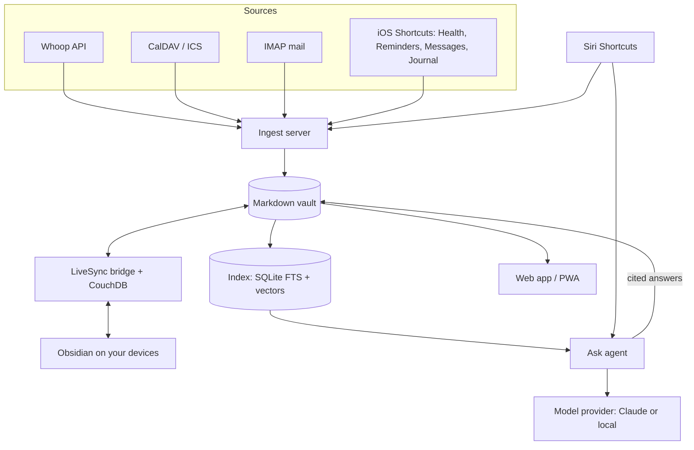

# Architecture

dashboardify is a personal command center. It pulls health, calendar, reminders, journal, mail and messages into one place, and lets you ask questions about all of it, mainly by voice through Siri.

## Principles

- **Files are the source of truth.** Everything lives in a Markdown vault (Obsidian-compatible), with YAML frontmatter for structured fields and CSV for time series. Nothing depends on a database you can't open in a text editor.
- **Derived data is disposable.** The search index and embeddings live in one SQLite file inside the vault (`.cc/`, git-ignored) and can be rebuilt from the files at any time.
- **No platform lock-in.** The server runs on Linux. Apple-only data (Health, Reminders, Messages) comes in through iOS Shortcuts posting JSON, so Apple is a source, not a dependency.
- **Swappable models.** Every model call goes through one provider interface: Anthropic (Claude) or any OpenAI-compatible endpoint (Ollama, llama.cpp, vLLM).
- **Private sources stay local.** Journal and messages are tagged `privacy: local-only` and are only ever processed by a model running on the server.

## Components



| Component | Responsibility |
| --- | --- |
| Ingest server | Receives pushes from Shortcuts, polls Whoop, CalDAV and IMAP, and writes into the vault. Only edits regions it owns, so hand-written text is never touched. |
| Vault | Daily notes, reminders mirror, health CSVs, message and mail digests, saved answers. Synced to your devices with Obsidian Self-hosted LiveSync. `livesync-bridge` keeps the server's plain-file vault and CouchDB in step. The server also commits its writes to a local git repo for history. |
| Index | Full-text and vector search plus typed tables parsed from frontmatter and CSVs, so "average HRV on short-sleep nights" is a query, not a guess. |
| Ask agent | Answers a question by searching the index with a fixed set of read-only tools, then writes a cited answer to the vault. |
| Web app | The dashboard (Today view) on desktop and phone. |
| Siri | The main way in. "Ask command center" dictates a question and reads the answer back; "Log journal" captures a line. Both are plain HTTP calls, so Siri can be replaced later without server changes. |

## Sources

| Source | How it arrives | Notes |
| --- | --- | --- |
| Whoop | Official Whoop API (OAuth), polled by the server | Recovery, sleep, strain, HRV |
| Apple Health | Daily Shortcut automation posts metrics | Steps, workouts, weight. Shortcuts can only read Health while the phone is unlocked. |
| Calendar | Server reads CalDAV (iCloud app password) and ICS feeds | Not written to Markdown files. Events live in the index, and each daily note gets a short agenda block. |
| Reminders | Shortcut posts open reminders | One-way mirror into the vault; you keep using Apple Reminders to tick things off. |
| Journal | Written in the daily note, or dictated through Siri | Local-only. |
| Mail | Server reads IMAP directly | Only messages that need you get a note. |
| Messages | Shortcut automation on "message received", filtered on the phone | iMessage has no server-side access. Local-only. |

## Vault layout

```
vault/
  daily/2026/2026-11-02.md        journal, health frontmatter, agenda block
  tasks/reminders.md              reminders mirror
  health/2026/2026-11.csv         one row per day
  inbox/mail/…                    one note per important email
  inbox/messages/2026-11-02.md    daily digest, local-only
  answers/…                       questions with cited answers
  notes/                          your own notes
  .cc/index.sqlite                derived, git-ignored
```

## Hosting

One process on an always-on Linux server, run with Docker or directly. The phone reaches it over Tailscale, so nothing is exposed to the internet. Push notifications go through ntfy.

## Design direction

Apple-native: system font, grouped background with rounded cards, large titles, and system colors used for meaning. Desktop gets a sidebar and a widget layout; the phone gets square widgets and a floating tab bar with a Siri button. The working mockups are in a separate design file and are not checked in here.
