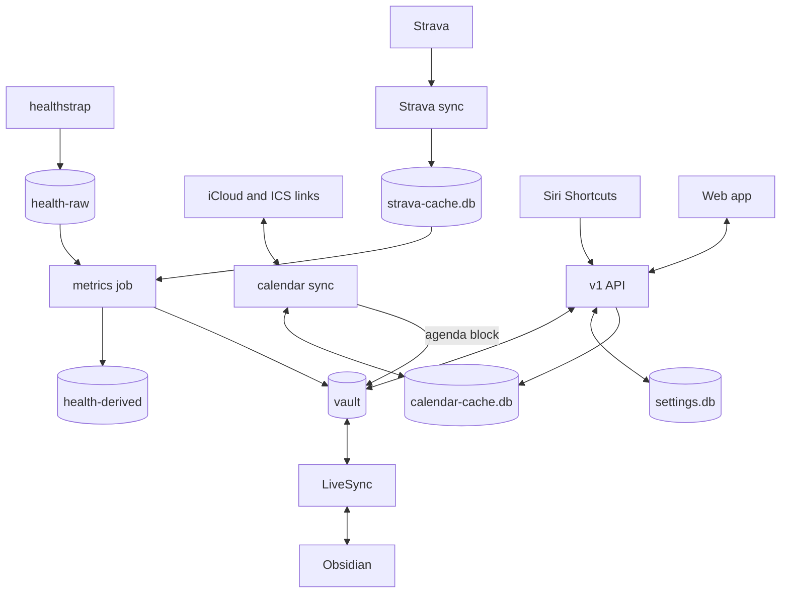

# Architecture

A personal command center: health, calendar, tasks, journal and (later) mail and messages in one
web app, controlled by voice through Siri. Parts marked *planned* aren't built
([roadmap.md](roadmap.md)).

## Principles

- **Files are the source of truth.** What you write lives in a Markdown vault (Obsidian). Server
  settings live in `settings.db` outside the vault, because they hold secrets that must never
  sync; `bun run settings export` gives a readable copy.
- **Derived data is disposable.** `calendar-cache.db`, `strava-cache.db` and `health-derived/`
  are rebuilt from iCloud, Strava and `health-raw/` when deleted.
- **The server only edits what it owns** in a note ([vault-format.md](vault-format.md)).
- **Apple is a source, not a dependency.** The server runs on Linux; Apple-only data arrives
  through Shortcuts.
- **Private sources stay local.** Journal and messages only reach a model running on the
  server (*planned*: Ask).

## Components



| Code | Does |
| --- | --- |
| `src/server/` | Auth, the v1 transports, one service per area in `api/` |
| `src/vault/` | Notes and tasks; atomic writes, one writer per file |
| `src/capture/` | Line → event or reminder, and the calendar guess. Shared with the web app. |
| `src/calendar/` | CalDAV client, iCalendar, accounts, cache, sync loop, ICS feeds, agenda block |
| `src/settings/` | `settings.db`, per-module migrations, secret box, devices, setup code |
| `src/health/` | Raw sample store, `metrics/` (one file per idea), daily summary, `feedback/` |
| `src/home/` | Everything the home screen shows, worked out on the server |
| `src/places/` | Photon place search |
| `web/` | Preact app, bundled by Bun from `web/index.html` and served by the same process |

## How a request flows

1. `proto/dashboardify/v1/<area>.proto` defines the resource and RPCs; `bun run proto:generate`
   writes `src/gen/` (checked in).
2. `src/server/api/<area>.ts` implements the service.
3. `src/server/routes/v1.ts` registers it and `src/server/api/rest-bindings.ts` maps REST paths.
   `v1-transport.ts` serves REST under `/v1` and Connect at `/dashboardify.v1.<Service>/<Method>`,
   validating each request with Protovalidate.
4. `web/api.ts` is the web app's only client.

The home screen is one call, `GET /v1/home`, refreshed every 5 minutes, on focus and at midnight.

## Sources

| Source | Arrives by |
| --- | --- |
| Whoop strap | healthstrap posts raw per-day streams to `/v1/streams/{stream}:mergeSamples`; stored as Parquet |
| Calendar | CalDAV every 2 min, ICS links every 15 ([calendar.md](calendar.md)) |
| Tasks, journal, check-ins | The capture box, Siri, or written in Obsidian |
| Messages | A phone Shortcut automation posts to `/v1/messages` |
| Runs | *Planned*: Apple Health or Strava |
| Mail | *Planned*: IMAP |

## Data on disk

```
vault/                          synced by LiveSync
  daily/2026/2026-11-02.md      journal, health, agenda, lifting log, reviews
  Inbox.md                      new tasks (any note can hold tasks)
  inbox/messages/2026-11-02.md  messages received that day
health-raw/                     Parquet per stream per UTC day
health-derived/                 rebuildable tables; params/ holds recovery weights
data/ (DATA_PATH)               settings.db, secret.key, calendar-cache.db, strava-cache.db, server.lock
```

## Security

- Every call needs a device token (stored only as a SHA-256 hash) or, behind Tailscale Serve, an
  allowed tailnet login from the configured proxy. Nothing is exposed to the internet.
- Secrets (calendar passwords, ICS URLs) are sealed with AES-256-GCM in `settings.db` and never
  returned. `secret.key` stays out of backups ([settings.md](settings.md#threat-model)).
- File paths are built only from validated dates and fixed names.
- Text from calendars is untrusted and rendered as text, never HTML.

## Web app

Each page is a module in `web/modules/` with its own address (`#/activity?range=month`), read
by `web/lib/router.ts`. `web/app.tsx` is the shell: sign-in, the home view, and the page for the
address. [navigation.md](navigation.md) plans the sidebar, command bar and search.
