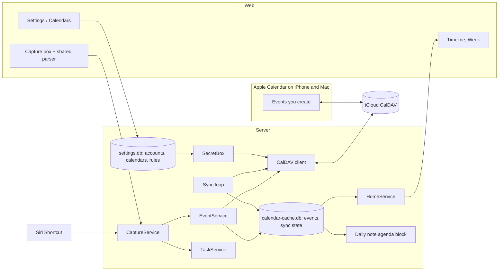

# Calendar

How two-way calendar sync with Apple Calendar works, and the one capture box that turns a line of
text into an event or a reminder. Built as C1–C13 (PRs #33–#61); the PR-by-PR plan is in git
history (`git show 7d6e452:docs/calendar-plan.md`). The UI design is on the Claude Design
canvas: https://claude.ai/artifact/YNnwtKHE7AAzjLswS4JnSc (artboards Main, Desktop and Phone for
capture; the "Settings › Calendars" row for Settings).

It sits on [settings](settings.md): `settings.db`, `SettingsStore`, `SecretBox` and the Settings
page shell. Place search for event locations (Photon, L1–L3) is in
[api.md](api.md#places).

## Goals

- See every calendar you use on the timeline and in the week view, within a few minutes of a
  change in Apple Calendar.
- Type one line in one box and get either a calendar event in iCloud or a reminder in the vault.
  The box shows which, and where, before you press Return.
- Connect one iCloud account and any number of calendar links (for example a work calendar
  published as an ICS URL), and choose their colours in Settings, not in `.env`.

## Non-goals

- Creating or editing recurring events. Occurrences of recurring events are read and shown.
- Moving an event between calendars, invites, attendees and alarms.
- Apple Reminders. Reminders are vault tasks with `⏰` (docs/vault-format.md).
- More than one iCloud account, Google CalDAV and Microsoft Graph. The data model leaves room
  for them (`kind`, `provider`), so each is a later PR with no migration. See
  [Later: more accounts](#later-more-accounts).
- Writing to linked calendars. A link is a read-only feed.
- Mirroring events into Markdown. The daily note gets an agenda block only.

## Decisions

| Area | Decision |
| --- | --- |
| Accounts | One iCloud account over CalDAV, read and write. Any number of calendar links (ICS URLs), read-only, one calendar each. Both are rows in `calendar_accounts` in `settings.db`. |
| One iCloud | A partial unique index allows one `caldav` row. A second `CreateCalendarAccount` with `KIND_CALDAV` returns `ALREADY_EXISTS`; to switch Apple IDs, remove the account first. |
| Links | Calendar links are added by URL. `webcal://` is read as `https://`; plain `http://` is refused. The URL is sealed like a password, because anyone with it can read the calendar. |
| Credentials | iCloud app-specific password and link URLs, sealed with `SecretBox`. |
| Writable | Taken from the server's `current-user-privilege-set`. A calendar can be forced read-only in Settings. In iCloud, calendars shared with you as view-only and subscribed calendars are read-only. |
| Categories | Each calendar maps to work, fitness, personal, relationships, family or focus. Default: personal. |
| Sync | Poll. CalDAV every 2 minutes with ctag and sync-token, so a quiet poll is one small request per calendar. One extra sync right after each write. Links every 15 minutes with a conditional GET. |
| Event cache | `$DATA_PATH/calendar-cache.db`, derived and disposable. Deleting it triggers a full resync. Kept apart from `settings.db` so exports and backups stay small. |
| Creates | `PUT {calendar}/{uid}.ics` with `If-None-Match: *`, where `uid` comes from the client's `request_id`. A retry becomes the same PUT and returns 412, which is read as success. |
| Edits | `PUT` with `If-Match: <etag>`. A stale etag returns `ABORTED` and the UI refreshes. |
| Deletes | `DELETE` with `If-Match`. Undo is a delete. |
| Dedupe | Events with the same iCalendar UID and recurrence-id on several calendars are drawn once, using the writable copy, else the first by calendar order. |
| Parsing | One shared module, `src/capture/`, used by the web app per keystroke and by the server for the final write and for Siri. |
| Calendar guess | Writable calendar most used for a similar past title, then keyword rules, then the default calendar. Same shared function on client and server. |
| Pending state | Client-side only. The server writes to CalDAV during the request; there is no server outbox in v1. |
| Libraries | Thin hand-written CalDAV client over `fetch`, `fast-xml-parser` for WebDAV XML, `ical.js` for iCalendar parsing, writing and recurrence expansion. |

## Architecture



### Components

| Module | Responsibility |
| --- | --- |
| `src/capture/parse.ts` | Pure: text + now + zone → kind, title, start/end or due/time, highlight spans, reason. No I/O, no Temporal (browser support is uneven), only chrono and `Intl`. |
| `src/capture/choose-calendar.ts` | Pure: title + hints + rules + default → calendar, with the step that matched. |
| `src/calendar/caldav.ts` | Discovery, PROPFIND, REPORT (`calendar-query`, `sync-collection`, `calendar-multiget`), PUT, DELETE. Talks only `fetch`. |
| `src/calendar/ical.ts` | iCalendar ↔ `CachedEvent`, using `ical.js`. Expands recurrences into a window. Writes single VEVENTs. |
| `src/calendar/accounts.ts` | Account and calendar rows in `settings.db`, migrations, sealed fields registered with `SettingsStore.registerSealed` so `bun run settings rotate-key` re-encrypts them. |
| `src/calendar/cache.ts` | `calendar-cache.db`: events, occurrences, sync state. |
| `src/calendar/sync.ts` | The sync loop: one worker per account, backoff, status per calendar. |
| `src/calendar/feed.ts` | Fetches a calendar link: conditional GET, `webcal:` to `https:`, size cap, redirect check. |
| `src/calendar/source.ts` | `CalendarSource` built on the cache, replacing `noCalendar` in `src/home/calendar.ts`. |
| `src/server/api/calendar-accounts.ts` | `CalendarAccountService`. |
| `src/server/api/events.ts` | `EventService`. |
| `src/server/api/capture.ts` | `CaptureService`. |

### Create from the UI

1. You type. The shared parser runs on every keystroke and the box highlights the phrases, picks
   Event or Reminder and shows the preview line with the chosen calendar. No network call.
2. Return sends `CaptureService.Capture` with the text, the client's `request_id`, and the kind
   and calendar if you switched them by hand.
3. The client draws the block at once with "Saving to iCloud…" (Desktop artboard), from its own
   parse result.
4. The server parses the text again with the same module (the server's clock and zone win), then:
   - event: `EventService.CreateEvent` → CalDAV PUT → cache upsert → response with the event;
   - reminder: `TaskService.CreateTask` with the same `request_id`.
5. The client swaps the pending block for the returned event and shows "Lunch with Sam added to
   Personal, today 12:30–13:30 · Undo". Undo calls `DeleteEvent` or `DeleteTask` with the etag.
6. On failure the block turns into an error row: "Couldn't save to iCloud. Retry". Retry sends the
   same `request_id`, so a write that did land is not doubled.

### Create from Apple Calendar

1. You add an event on your phone. It goes to iCloud.
2. Within 2 minutes the sync loop sees a new ctag on that calendar and runs `sync-collection` from
   the stored sync-token. iCloud returns the changed hrefs; a `calendar-multiget` fetches them.
3. The events are parsed, recurrences expanded for the window, and the cache updated in one
   transaction. Deleted hrefs are removed.
4. The next `GetHome` (the web app refreshes every 5 minutes and when the tab comes back) shows it.
   "Calendar synced 09:10" next to the heading is the oldest successful sync across calendars.

### Sync loop

| Step | Detail |
| --- | --- |
| Discovery | On account add and daily: `current-user-principal` → `calendar-home-set` (iCloud redirects to a `pNN-caldav.icloud.com` host; store it) → list calendars with `displayname`, `calendar-color`, `getctag`, `sync-token`, `current-user-privilege-set`, `supported-calendar-component-set`. Calendars without VEVENT (iCloud task lists) are skipped. |
| Poll | Every 2 minutes per CalDAV account: one PROPFIND depth 1 for all ctags. Unchanged ctag → done. |
| Incremental | `sync-collection` with the stored token. If the server rejects the token (403/409 `valid-sync-token`), fall back to a full `calendar-query` for the window and compare etags. |
| Window | 30 days back, 60 days ahead, for occurrences. Masters of recurring events are kept whole. The past 180 days of titles feed the calendar guess. |
| After a write | Sync that calendar immediately so the server's etag and any server-side edits land in the cache. |
| Errors | Exponential backoff per account, 2 minutes up to 1 hour. 401 marks the account "Sign-in failed" in Settings and stops polling until the password is replaced. |
| Startup | Serve from the cache at once; sync in the background. |
| Links | Every 15 minutes per link: `GET` with `If-None-Match` / `If-Modified-Since`. 304 → done. 200 → parse with `ical.js` and replace that calendar's rows in one transaction. 30 s timeout, 10 MB cap, at most 5 redirects and all of them `https:`. 401, 403, 404 and 410 mark the link "Link stopped working" and back off to once an hour; other errors use the CalDAV backoff. |
| Account changes | Each tick checks `store.version()` (`PRAGMA data_version`). A change, from the API or the CLI, reloads accounts and calendars before polling, so a new password or a removed account applies within one tick without a restart. |

### Conflicts

- Every cached event keeps its CalDAV `etag` and href. The API exposes the etag as the resource
  etag. Writes send `If-Match`, and a 412 comes back as `ABORTED: changed in Apple Calendar`.
- Creates can't conflict: the href is new and `If-None-Match: *` makes retries safe.
- The server never merges field by field. The version in iCloud wins, and the UI reloads.

### Time zones and all-day events

- Timed events are stored as UTC instants plus the event's own `TZID`, so editing keeps the zone.
  `ical.js` resolves `VTIMEZONE` blocks; floating times are read in the server's zone.
- New events are written with `TZID` set to `settings.time_zone` (S3; `TZ_NAME` still overrides it)
  and a matching `VTIMEZONE`.
- All-day events are `VALUE=DATE` spans. They show in a row above the Day timeline (never on
  it), and as hollow markers in the Week view's dated-task area, labelled as events. The capture box never creates all-day events;
  "Dentist Friday" with no time stays a dated task. Revisit with the design.
- An event over midnight is split per day, as `agenda.ts` already does with `endMin` past 1440.

### Recurring events

- Read: occurrences in the window are expanded with `ical.js`, including `EXDATE` and overridden
  instances (`RECURRENCE-ID`). Each occurrence is its own `Event` with `recurring: true`.
- Create: single events only. "Gym every Monday 7am" becomes a reminder with `🔁` (tasks already
  support recurrence) and the reason line says recurring events come later.
- Edit and delete of recurring events: not offered in v1. The API returns `FAILED_PRECONDITION`.

## Data model

Tables in `settings.db`, registered as calendar migrations with `SettingsStore`:

```sql
CREATE TABLE calendar_accounts (
  id TEXT PRIMARY KEY,                 -- short slug, e.g. "icloud"
  kind TEXT NOT NULL,                  -- caldav | ics
  provider TEXT NOT NULL,              -- icloud for caldav; url for ics (google, other later)
  display_name TEXT NOT NULL,
  server_url TEXT,                     -- discovery URL
  home_url TEXT,                       -- resolved calendar-home-set
  username TEXT,
  password_sealed BLOB,                -- SecretBox, AAD calendar_accounts/<id>/password
  feed_url_sealed BLOB,                -- ics only; SecretBox, AAD calendar_accounts/<id>/feed_url
  feed_host TEXT,                      -- ics only; host of the URL, shown in Settings
  http_etag TEXT,                      -- ics only; for the conditional GET
  http_last_modified TEXT,             -- ics only
  last_used_time TEXT,                 -- last successful authenticated request
  status TEXT NOT NULL DEFAULT 'ok',   -- ok | auth_failed | unreachable
  status_detail TEXT,
  create_time TEXT NOT NULL,
  update_time TEXT NOT NULL
);
CREATE UNIQUE INDEX one_caldav_account ON calendar_accounts (kind) WHERE kind = 'caldav';

-- An ics account has exactly one calendar, id "feed", server_writable 0.
CREATE TABLE calendars (
  account_id TEXT NOT NULL REFERENCES calendar_accounts(id) ON DELETE CASCADE,
  id TEXT NOT NULL,                    -- slug from the collection path
  href TEXT NOT NULL,
  display_name TEXT NOT NULL,
  server_color TEXT,                   -- from calendar-color, shown in Settings only
  category TEXT NOT NULL DEFAULT 'personal',
  server_writable INTEGER NOT NULL,    -- from privileges
  force_read_only INTEGER NOT NULL DEFAULT 0,
  enabled INTEGER NOT NULL DEFAULT 1,
  sort INTEGER NOT NULL DEFAULT 0,
  PRIMARY KEY (account_id, id)
);

CREATE TABLE calendar_settings (       -- one row
  id INTEGER PRIMARY KEY CHECK (id = 1),
  default_account_id TEXT,
  default_calendar_id TEXT,
  keyword_rules TEXT NOT NULL DEFAULT '[]'  -- JSON [{ "words": ["gym","run"], "calendar": "icloud/fitness" }]
);
```

Every sealed column is registered at module load:

```ts
SettingsStore.registerSealed("calendar_accounts", "id", ["password_sealed", "feed_url_sealed"]);
```

`calendar-cache.db` (owned by `src/calendar/cache.ts`, not the settings store):

```sql
CREATE TABLE sync_state (account_id TEXT, calendar_id TEXT, ctag TEXT, sync_token TEXT,
  last_sync_time TEXT, last_error TEXT, PRIMARY KEY (account_id, calendar_id));
CREATE TABLE resources (account_id TEXT, calendar_id TEXT, href TEXT, etag TEXT, ics TEXT,
  PRIMARY KEY (account_id, calendar_id, href));
CREATE TABLE occurrences (event_id TEXT PRIMARY KEY, account_id TEXT, calendar_id TEXT,
  href TEXT, uid TEXT, recurrence_id TEXT, title TEXT, title_key TEXT, location TEXT,
  url TEXT, start_ms INTEGER, end_ms INTEGER, all_day INTEGER, recurring INTEGER, tzid TEXT);
CREATE INDEX occurrences_time ON occurrences (start_ms, end_ms);
CREATE INDEX occurrences_title ON occurrences (title_key);
```

`event_id` is the first 16 base32 characters of SHA-256 over `account/calendar/uid/recurrence-id`.
It is stable across syncs and known to the client before the server answers, because created
events use `uid = <request_id>@dashboardify`. `title_key` is the lower-cased title with dates,
times and punctuation removed, for the calendar guess.

## APIs

All new services follow the v1 conventions in docs/api.md: AIP resource names, REST bindings,
Connect, protovalidate, etags, update masks and page tokens.

### CalendarAccountService

```proto
service CalendarAccountService {
  rpc ListCalendarAccounts(ListCalendarAccountsRequest) returns (ListCalendarAccountsResponse) {
    option (google.api.http) = {get: "/v1/calendarAccounts"};
  }
  rpc GetCalendarAccount(GetCalendarAccountRequest) returns (CalendarAccount) {
    option (google.api.http) = {get: "/v1/{name=calendarAccounts/*}"};
  }
  // Tests the credentials (CalDAV) or fetches the feed (ICS) and lists its calendars before
  // saving. With validate_only, saves nothing. A second CalDAV account is ALREADY_EXISTS.
  rpc CreateCalendarAccount(CreateCalendarAccountRequest) returns (CalendarAccount) {
    option (google.api.http) = {post: "/v1/calendarAccounts" body: "calendar_account"};
  }
  // Replaces the password or the link URL, or renames.
  rpc UpdateCalendarAccount(UpdateCalendarAccountRequest) returns (CalendarAccount) {
    option (google.api.http) = {patch: "/v1/{calendar_account.name=calendarAccounts/*}" body: "calendar_account"};
  }
  rpc DeleteCalendarAccount(DeleteCalendarAccountRequest) returns (google.protobuf.Empty) {
    option (google.api.http) = {delete: "/v1/{name=calendarAccounts/*}"};
  }
  // Runs discovery and a sync now.
  rpc SyncCalendarAccount(SyncCalendarAccountRequest) returns (CalendarAccount) {
    option (google.api.http) = {post: "/v1/{name=calendarAccounts/*}:sync" body: "*"};
  }
  rpc ListCalendars(ListCalendarsRequest) returns (ListCalendarsResponse) {
    option (google.api.http) = {get: "/v1/{parent=calendarAccounts/*}/calendars"};
  }
  // Category, enabled, force_read_only.
  rpc UpdateCalendar(UpdateCalendarRequest) returns (Calendar) {
    option (google.api.http) = {patch: "/v1/{calendar.name=calendarAccounts/*/calendars/*}" body: "calendar"};
  }
  rpc GetCalendarSettings(GetCalendarSettingsRequest) returns (CalendarSettings) {
    option (google.api.http) = {get: "/v1/{name=calendarSettings}"};
  }
  // Default calendar and keyword rules.
  rpc UpdateCalendarSettings(UpdateCalendarSettingsRequest) returns (CalendarSettings) {
    option (google.api.http) = {patch: "/v1/{calendar_settings.name=calendarSettings}" body: "calendar_settings"};
  }
}

message CalendarAccount {
  // calendarAccounts/{account}
  string name = 1 [(google.api.field_behavior) = IDENTIFIER];
  enum Kind { KIND_UNSPECIFIED = 0; KIND_CALDAV = 1; KIND_ICS = 2; }
  Kind kind = 2 [(google.api.field_behavior) = IMMUTABLE];
  string provider = 3;                 // icloud for CALDAV, url for ICS (google, other later)
  string display_name = 4;
  string server_url = 5;
  string username = 6;
  string password = 7 [(google.api.field_behavior) = INPUT_ONLY];
  bool password_set = 8 [(google.api.field_behavior) = OUTPUT_ONLY];
  string feed_url = 9 [(google.api.field_behavior) = INPUT_ONLY];             // ICS; https: or webcal:
  bool feed_url_set = 10 [(google.api.field_behavior) = OUTPUT_ONLY];
  string feed_host = 16 [(google.api.field_behavior) = OUTPUT_ONLY];           // e.g. outlook.office365.com
  google.protobuf.Timestamp last_used_time = 11 [(google.api.field_behavior) = OUTPUT_ONLY];
  google.protobuf.Timestamp last_sync_time = 12 [(google.api.field_behavior) = OUTPUT_ONLY];
  enum Status { STATUS_UNSPECIFIED = 0; STATUS_OK = 1; STATUS_AUTH_FAILED = 2; STATUS_UNREACHABLE = 3; }
  Status status = 13 [(google.api.field_behavior) = OUTPUT_ONLY];
  string status_detail = 14 [(google.api.field_behavior) = OUTPUT_ONLY];
  string etag = 15;
}

message Calendar {
  // calendarAccounts/{account}/calendars/{calendar}
  string name = 1 [(google.api.field_behavior) = IDENTIFIER];
  string display_name = 2 [(google.api.field_behavior) = OUTPUT_ONLY];
  string server_color = 3 [(google.api.field_behavior) = OUTPUT_ONLY];
  string category = 4;                 // work, fitness, personal, focus
  bool enabled = 5;
  bool force_read_only = 6;
  bool writable = 7 [(google.api.field_behavior) = OUTPUT_ONLY];  // server_writable && !force_read_only && kind == CALDAV
  google.protobuf.Timestamp last_sync_time = 8 [(google.api.field_behavior) = OUTPUT_ONLY];
}

message CreateCalendarAccountRequest {
  CalendarAccount calendar_account = 1 [(google.api.field_behavior) = REQUIRED];
  string calendar_account_id = 2;      // slug; "icloud" for CALDAV, from display_name for ICS
  bool validate_only = 3;              // the "Test" step of the add flow
}
```

`CreateCalendarAccount` with `validate_only` returns the account with its discovered calendars
in a `calendars` field, so Settings can show them before you save. Bad credentials return
`UNAUTHENTICATED` with Apple's hint ("Use an app-specific password from appleid.apple.com").
For a link, `validate_only` fetches the feed once and returns its `X-WR-CALNAME` as the suggested
`display_name` and the number of events in the window; a page that is not iCalendar returns
`INVALID_ARGUMENT` ("That link isn't a calendar feed").

### EventService

```proto
service EventService {
  rpc GetEvent(GetEventRequest) returns (Event) {
    option (google.api.http) = {get: "/v1/{name=events/*}"};
  }
  // From the cache. filter on start_time, end_time and calendar, e.g.
  // `end_time > "2026-11-10T00:00:00Z" AND start_time < "2026-11-17T00:00:00Z"`.
  rpc ListEvents(ListEventsRequest) returns (ListEventsResponse) {
    option (google.api.http) = {get: "/v1/events"};
  }
  // Writes through to the calendar server before returning.
  rpc CreateEvent(CreateEventRequest) returns (Event) {
    option (google.api.http) = {post: "/v1/events" body: "event"};
  }
  // title, location, notes, start_time, end_time. Not calendar, not recurring events.
  rpc UpdateEvent(UpdateEventRequest) returns (Event) {
    option (google.api.http) = {patch: "/v1/{event.name=events/*}" body: "event"};
  }
  rpc DeleteEvent(DeleteEventRequest) returns (google.protobuf.Empty) {
    option (google.api.http) = {delete: "/v1/{name=events/*}"};
  }
}

message Event {
  // events/{event}
  string name = 1 [(google.api.field_behavior) = IDENTIFIER];
  // calendarAccounts/{account}/calendars/{calendar}
  string calendar = 2 [(google.api.field_behavior) = REQUIRED];
  string title = 3 [(google.api.field_behavior) = REQUIRED];
  google.protobuf.Timestamp start_time = 4 [(google.api.field_behavior) = REQUIRED];
  google.protobuf.Timestamp end_time = 5 [(google.api.field_behavior) = REQUIRED];
  string time_zone = 6;                // IANA; defaults to the server's
  bool all_day = 7 [(google.api.field_behavior) = OUTPUT_ONLY];
  string location = 8;
  string notes = 9;
  string url = 10;
  string category = 11 [(google.api.field_behavior) = OUTPUT_ONLY];
  bool writable = 12 [(google.api.field_behavior) = OUTPUT_ONLY];
  bool recurring = 13 [(google.api.field_behavior) = OUTPUT_ONLY];
  string uid = 14 [(google.api.field_behavior) = OUTPUT_ONLY];
  string etag = 15;
}

message CreateEventRequest {
  Event event = 1 [(google.api.field_behavior) = REQUIRED];
  string request_id = 2;               // becomes the UID; retries are safe
}
```

Errors: read-only calendar → `PERMISSION_DENIED`; stale etag → `ABORTED`; recurring →
`FAILED_PRECONDITION`; calendar server down → `UNAVAILABLE`; end before start → `INVALID_ARGUMENT`.

### CaptureService

One endpoint for "turn this line into the right thing", used by the web box and Siri.

```proto
service CaptureService {
  // Parses without writing. For Siri ("did you mean…") and for tests; the web parses locally.
  rpc ParseCapture(ParseCaptureRequest) returns (CaptureParse) {
    option (google.api.http) = {post: "/v1/captures:parse" body: "*"};
  }
  // Parses, then creates an event or a task.
  rpc Capture(CaptureRequest) returns (CaptureResponse) {
    option (google.api.http) = {post: "/v1/captures" body: "*"};
  }
}

message CaptureRequest {
  string text = 1 [(google.api.field_behavior) = REQUIRED];
  string request_id = 2;
  CaptureKind kind = 3;                // set only when switched by hand
  string calendar = 4;                 // set only when picked by hand
}

enum CaptureKind { CAPTURE_KIND_UNSPECIFIED = 0; CAPTURE_KIND_EVENT = 1; CAPTURE_KIND_REMINDER = 2; }

message CaptureParse {
  CaptureKind kind = 1;
  string reason = 2;                   // "It has an end time or a length, so it blocks time."
  string title = 3;
  google.protobuf.Timestamp start_time = 4;   // events
  google.protobuf.Timestamp end_time = 5;
  google.type.Date due_date = 6;              // reminders
  google.type.TimeOfDay due_time = 7;
  string recurrence = 8;                      // reminders only
  string calendar = 9;                        // events
  string calendar_reason = 10;                // "Physio is usually on Fitness"
  repeated CaptureSpan spans = 11;            // [start, end) in UTF-16 units, kind when | who
}

message CaptureResponse {
  CaptureParse parse = 1;
  oneof result { Event event = 2; dashboardify.v1.Task task = 3; }
  string message = 4;                  // sentence for Siri and the "added" line
}
```

`VoiceService.AddTask` stays as it is (Siri's "Add a task"). A new Shortcut, "Add to command
center", calls `Capture`, so Siri can make events too.

### Where parsing runs

Shared code, run in both places.

- **Client:** the box must react on every keystroke with no lag, so the web app imports
  `src/capture/parse.ts` and `choose-calendar.ts` directly, as it already imports
  `src/home/types.ts`. Bun bundles chrono (about 40 kB gzipped) into the web build.
- **Server:** `Capture` parses again with the same code. The server's clock and zone are
  authoritative, Siri has no client parser, and a stale tab can't write the wrong day.
- **Agreement:** both run the same function on the same inputs. The calendar guess needs history,
  so `GetHome` ships `capture_hints` (below). If the server's result differs from what the client
  showed (for example the tab is a day old), the server's wins and the "added" line says what was
  made.
- `parseWhen` in `src/vault/when.ts` moves into the shared module. It drops Temporal for `Intl`
  offset math, since Temporal isn't in every browser the phone may use. `when.ts` re-exports it so
  existing callers don't change.

### Calendar guess

`chooseCalendar(title, hints, rules, defaultCalendar)`:

1. Writable calendar with the most past events whose `title_key` matches, or shares its first
   word with, this title (for example "Physio" → Fitness). Ties go to the most recent.
2. The first keyword rule whose words appear in the title.
3. The default calendar. If none is set, the first writable calendar.

A hand-picked calendar always wins and holds until the box is cleared, like the kind switch.

### Calendar fields in GetHome

```proto
message AgendaEvent {
  // ...existing fields 1–8...
  string event = 9;                    // events/{event}
  string calendar = 10;                // calendarAccounts/{a}/calendars/{c}
  bool writable = 11;
  bool all_day = 12;
}

message DayAgenda {
  // ...existing fields...
  repeated AgendaEvent all_day_events = 5;   // Week view markers only
}

message Home {
  // ...existing fields...
  CalendarSync calendar_sync = 20;           // "Calendar synced 09:10", stale after 15 min
  CaptureHints capture_hints = 21;
}

message CalendarSync {
  google.protobuf.Timestamp last_sync_time = 1;  // oldest successful sync across enabled calendars
  bool has_errors = 2;                           // any account with auth_failed or unreachable
}

message CaptureHints {
  repeated WritableCalendar calendars = 1;   // name, display name, category
  string default_calendar = 2;
  repeated KeywordRule rules = 3;
  repeated TitleHint titles = 4;             // title_key → calendar, top 300 by count, past 180 days
}
```

There is no pending field on the server. Pending is the client's state between sending `Capture`
and getting an answer; the block and its "Saving to iCloud…" line live in the web app only.

`CalendarSource` in `src/home/calendar.ts` keeps its shape and gains `event`, `calendar`,
`writable` and `allDay` fields; the cache-backed source replaces `noCalendar` in `main.ts` when
any account or link exists.

The daily note gets a machine-owned `<!-- cc:agenda -->` block ([vault format](vault-format.md)) with today's events as `- 10:00–10:15 Standup`, rewritten after each sync that
changes today.

## Libraries

| Need | Choice | Why |
| --- | --- | --- |
| CalDAV | Hand-written, about 300 lines over `fetch` | We need six requests (PROPFIND, three REPORTs, PUT, DELETE). `tsdav` covers them but brings its own fetch polyfill, auth layers and OAuth paths we don't use, and is harder to read in one sitting. A small client is easy to review and to test against a fake server. |
| WebDAV XML | `fast-xml-parser` | Small, no dependencies, maintained, works in Bun. Responses are read with namespace-aware paths. |
| iCalendar | `ical.js` (Mozilla) | Handles `VTIMEZONE`, `RRULE`, `EXDATE` and `RECURRENCE-ID` correctly, which is where hand-written parsers break. Also writes VEVENTs. No dependencies. |

Versions are pinned exactly in `package.json`. `ical.js` is server-only; the web never parses
iCalendar.

## Security

- Passwords and link URLs are sealed with `SecretBox` (AADs `calendar_accounts/<id>/password`
  and `calendar_accounts/<id>/feed_url`) and never returned. Settings shows only the link's host.
- Fetching a link is a request to a URL you typed, from the server. Only `https:` (and `webcal:`
  read as `https:`), every redirect must stay `https:`, and responses over 10 MB are cut off.
  Request logs show the host, never the path or query, since the token is usually there.
- CalDAV only over HTTPS. Redirects are followed only to hosts under the same provider domain
  (`*.icloud.com`), so a redirect can't send the password elsewhere.
- Requests carry Basic auth only to the account's own host. No credentials in logs; request logs
  redact `Authorization`.
- Event text from calendars is untrusted. It is rendered as text in Preact, never as HTML, and
  links are only shown as Join buttons for `https:` URLs.
- `calendar-cache.db` holds event contents in plain text. It lives in `DATA_PATH` with mode 0600,
  is left out of the vault, and does not need backing up.
- Writes are limited to calendars marked writable, checked on the server, not only in the UI.

## Testing

- **Unit:** parser table, calendar guess, iCalendar fixtures, XML parsing.
- **Integration:** the real Hono app against the fake CalDAV server, with an isolated vault and
  temporary `settings.db` and `calendar-cache.db` per test (extend `test/server/api/helpers.ts`).
- **No network in tests**, as [style.md](style.md#tests) requires. The CalDAV client takes a
  `fetch`, so tests inject the fake server's handler.

### Manual end-to-end checklist (real iCloud)

1. Make an app-specific password at appleid.apple.com. Add the iCloud account in Settings; Test
   lists your calendars and marks shared view-only calendars read-only.
2. Set categories and the default calendar. A calendar shared with you as view-only shows read-only.
3. Type "Lunch with Sam tomorrow 12:30–13:30". Purple highlight, Event, Personal. Return.
   The block shows "Saving to iCloud…", then settles. It appears in Apple Calendar on the phone.
4. Undo. It disappears from Apple Calendar.
5. Type "Call dentist Fri 10:00". Reminder, dashed. It lands in `Inbox.md` with `⏰ 10:00`.
6. Type "Coffee with Priya Thu 3pm", switch to Reminder by hand, add. It becomes a task.
7. On the phone, add an event in Apple Calendar. It shows on the home screen within 2 minutes.
8. Edit that event's time on the phone. The home screen follows. Delete it; it goes.
9. Add a recurring event on the phone. Its occurrences show in Week.
10. Turn off Wi-Fi on the server and add an event. The error row and Retry appear. Turn it back
    on and Retry; exactly one event exists.
11. Revoke the app-specific password. Settings shows "Sign-in failed"; the label turns orange.
12. Say "Add to command center: gym tomorrow 7am for an hour" to Siri. A Fitness event appears.
13. In Settings, try to connect a second iCloud account. There is no button for it; the API
    returns `ALREADY_EXISTS`.
14. Add your work calendar's published ICS link as Work. Its events show within a minute of
    adding and are read-only when opened. It is not offered for new events.
15. Unpublish that calendar at the source. Within the hour the link shows "Link stopped working".

## Later: more accounts

Not built. Each is one PR and needs no migration:

| Account | How | Notes |
| --- | --- | --- |
| A second iCloud account | Drop the `one_caldav_account` index | The sync loop and APIs already handle several accounts. |
| Google | The same CalDAV client, with an app password | Read and write. Redirect check widened to `*.google.com`. |
| Microsoft Graph | OAuth app | Only if a 15-minute link is too slow or the work calendar can't be published. Usually needs IT approval. |

## Open questions

- [x] All-day events: Week markers only, or a place on the Day view too? A row above the Day
      timeline (C13).
- [ ] Should the box create events with no time ("Dentist Friday") as all-day events, or keep
      them as dated tasks as planned?
- [ ] Poll every 2 minutes for CalDAV: fast enough, or should the home screen trigger a sync when
      it loads and the last one is over a minute old?
