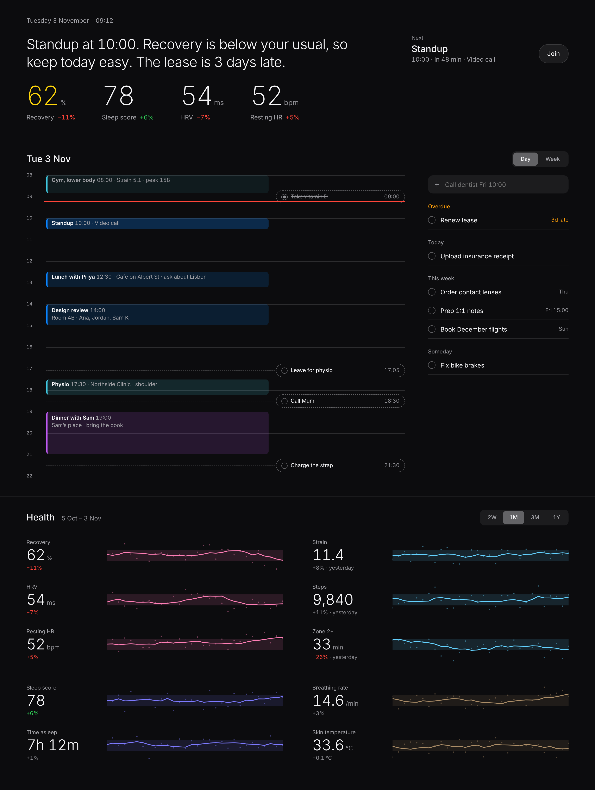
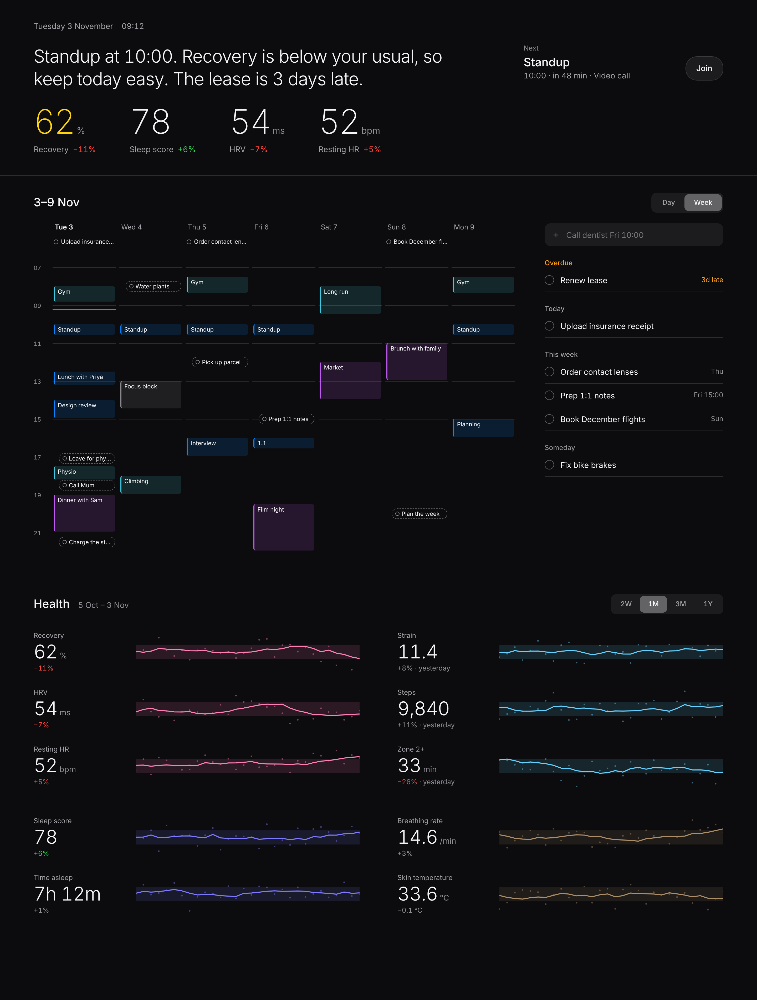
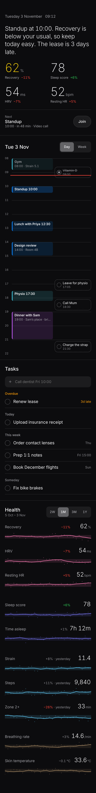
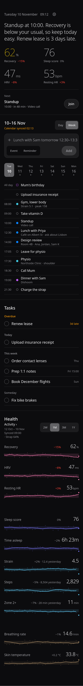

# Design

The home screen, Health and Activity pages and the rules every screen follows. Canvases: home
https://claude.ai/artifact/UfZhR2WaR4YVkhaPHHsVv3, capture and Settings
https://claude.ai/artifact/YNnwtKHE7AAzjLswS4JnSc, Activity
https://claude.ai/artifact/Dm3mFqJPttBWpS9VxeYPUD. `home-desktop.dc.html` (1440 wide) and
`home-phone.dc.html` (390 wide) here are references with made-up data, not shipped code.

| Desktop, Day | Desktop, Week |
|---|---|
|  |  |

| Phone, Day | Phone, Week |
|---|---|
|  |  |

## Home screen, top to bottom

1. **Focus.** Date, time and one sentence that judges and names the next action without
   repeating numbers. Recovery, sleep score, HRV and resting HR with their change. The next event,
   with Join for a call and Map for a located place. Pages are in the sidebar on desktop and the
   tab bar on the phone ([navigation.md](../navigation.md)).
   Under it, today's habits as chips: an outlined dot in the habit's colour, filled with the chip
   tinted once done ([Habits page](#habits-page)).
2. **Calendar and tasks.** Day/Week toggle; "Calendar synced 09:10" (orange past 15 min or on an
   account error).
   - **Day:** a timeline from an hour before now to 22:00 with a red now line. It shows at least
     eight hours and scrolls up to the day's first event or task, so a past task can still be
     ticked off. Short events take
     one line. Overlapping events sit side by side. Timed reminders (`⏰`) are dashed pills in a
     lane to the right. All-day events are slim bars in a row above the timeline. Tapping an event
     opens the event panel (view, Edit, Delete with one confirm); repeating and read-only events
     show why they can't be changed.
   - **Week:** desktop has seven columns with dated tasks on top; the phone has a day strip and
     that day's agenda. Events are filled markers, reminders hollow, all-day events hollow
     squares. Events show their location under the title, as plain text, and open the same
     event panel as the Day view.
   - **Capture box** under the heading: highlights the time, person and place as you type, shows
     Event or Reminder with the reason and a preview line (title, when, calendar button). A place
     line shows the match with "1 of 5". Return adds; the added line has Undo; `N` focuses it. A
     saving event is already on the timeline with a ring and "Saving to iCloud…".
   - **Tasks:** Overdue, Today, This week, Later, Someday; a side column on desktop, its own
     section on the phone.
3. **Health trends.** 2W/1M/3M/1Y; "Synced 14:02" and the strap's battery, orange past two hours.

## One home per item

- A time today → the timeline only. No time → the task list only. All-day events are not tasks.
- Overdue items: the task list, plus at most one mention in the sentence.
- Week shows dated tasks as hollow markers you can't tick; ticking is in the task list.

## Health numbers

- **Rows:** fifteen. Heart: recovery, HRV, resting HR, VO2max. Sleep: score, time asleep, deep,
  REM. Activity: strain, steps, zone 2+, calories, training load. Vitals: breathing, skin
  temperature. A row without data (no profile weight, too few nights) shows "–" and no change.
- **Time basis:** snapshot metrics show this morning's value; cumulative ones (strain, steps,
  zone 2+, calories) show today so far with yesterday's total beside the change. Partial days
  never feed a comparison.
- **Change:** the 7-day mean against the 60 days before, as a percentage (skin temperature in
  °C). The range switch changes only the chart.
- **Colour:** green good, red bad, grey under half a standard deviation. Up is good for recovery,
  HRV, VO2max, sleep, deep, REM, steps and zone 2+; down for resting HR; strain, calories,
  training load, breathing and skin temperature are always grey.
- **Charts:** fixed y-range of baseline ± 3 SD, a band at ± 1 SD, the 7-day rolling mean, faint
  daily dots, weekly means for 1Y, a solid dot at today.
- **Order:** heart, sleep, activity, vitals, separated by space, not labels. Desktop has heart and
  sleep on the left, activity and vitals on the right; the phone lists them in one column.
- **Sleep rows** (score, time asleep, deep, REM) go to that night on the Health page. The
  "Health" heading links there too.

## Activity page

`#/activity`, from the sidebar or the Health heading. Week lists each day's sessions, Month is a calendar with a
chip per session, 3M is active minutes per week. A day, week or workout opens beside the list
(below it on the phone). Workouts are activity cyan, walks teal `#66D4CF`; an unsure workout has a
dashed outline and `?`, and only its detail asks "What was this?" ("It was lifting" or "Not a
workout"; others have "Not right?"). Dismissed ones stay greyed with Undo. The detail shows HR
every 15 s; for lifting each set is a band in its exercise's colour (paler for warm-ups). A row and
the detail show calories when the profile allows ("strain 9.6 · 667 kcal"). A Strava run shows
distance and pace before them, links to Strava, and its HR covers the walks
either side, shaded teal. A Running total joins the row above when the range has runs.

## Health page

`#/health`, with the same heading, range switch and sync labels as home. Recovery heads it, then
Sleep, Heart and Vitals, each a column of home's rows given the full width. Sleep starts with a
night, last night unless `?night=2026-11-12` names one: its times ("23:41–07:05"), time asleep
and score, then a hypnogram (awake, REM, light and deep lanes in shades of the sleep colour, hour
ticks in the server's time zone), the stage totals and "Estimated", plus "· unusual night" when
the stages look unlike yours. Links step to the night before or after and replace the history
entry, so Back leaves the page. Every row and the range label are as of that night's day.

## Habits page

`#/habits`; canvas https://claude.ai/artifact/PQe6S6nfjyGt242ui4udNK. A row per habit: a 20 px
tick for today beside the name (22 px, 44 px to tap, on the phone), the schedule and what ticks
it, the streak in large type with the 30-day count under it, or this week as dots for a weekly
habit. To the right, a GitHub-style grid of 36 weeks (23 on the phone), Monday at the top: the
habit's colour when done, `#2A2A2E` when missed, an outline when not scheduled, a dashed outline
while its fact is pending, a ring on today. A weekly habit has one square per week, dashed
while this week is open; its next dot to fill is a ring in its colour. Narrow windows drop the
oldest weeks. On desktop a
square is a button that fixes its day; on the phone a habit's screen has this week's seven days
to tap. The selected habit's settings sit beside the list. A streak at risk is `warn` orange; a
paused habit's done squares are its colour at 40%.

## Look

Dark mode only (`color-scheme: dark`), Apple's dark system colours. Past items dim by colour and
fill alpha, never opacity. No cards on the main sections: hairlines and space do the grouping.
No explanatory labels.

| Neutral | Hex | Use |
|---|---|---|
| background | `#0C0C0E` | page |
| text | `#F5F5F7` | primary text |
| text-2 | `#A1A1A6` | labels, past titles |
| text-3 | `#8E8E93` | dimmest text allowed |
| fill | `#1C1C1E` | segmented track, capture box, buttons |
| line-2 | `#2C2C2E` | dividers, hour lines |
| line-3 | `#3A3A3C` | button outlines, reminder guides |
| control | `#636366` | selected segment, checkbox rings; never text |

| Status (never a category) | Hex | Use |
|---|---|---|
| good | `#30D158` | recovery 67–100, good change |
| caution | `#FFD60A` | recovery 34–66 |
| bad | `#FF453A` | recovery 0–33, bad change, the now line |
| warn | `#FF9F0A` | overdue, stale sync |

| Calendar category | Hex | | Health group | Hex |
|---|---|---|---|---|
| work | `#0A84FF` | | heart | `#FF7EB6` |
| fitness | `#40C8E0` | | sleep | `#7D7AFF` |
| personal | `#BF5AF2` | | activity | `#64D2FF` |
| relationships | `#FF375F` | | vitals | `#AC8E68` |
| family | `#5E5CE6` | | | |
| focus | `#8E8E93` | | | |

Recovery's band colour shows only in the focus row, always beside its number. The sentence has no
colour.

**Controls:** segmented controls on `fill` with a `control` selected segment; dropdowns are
`PickMenu` (a `fill` pill and a menu with a tick by the current choice), never a bare `<select>`; checkboxes are
1.5 px `control` rings that fill when done; touch targets 44 px on the phone; task rows are the
hit area.

**Type:** the system font, tabular figures. Every size is a `--type-*` token in `web/styles.css`
(a test rejects raw pixels); the phone changes the token, not the element.

| Token | Desktop | Phone | Use |
|---|---|---|---|
| caption | 11 | 11 | hour labels, axis ticks, chips, tab bar |
| footnote | 13 | 13 | metadata, notes, group labels, small buttons |
| body | 15 | 17 | rows, inputs and their placeholders, buttons |
| headline | 17 | 17 | group headings, units beside big numbers |
| title | 22 | 20 | section headings, the next event, dialogs |
| large | 28 | 34 | page titles |
| display | 34 | 24 | the sentence, health and activity numbers |
| hero | 64 | 48 | the focus numbers |

Weight 200 only for hero, 300 for large and display. Formats: "3 Nov", 24-hour times, "7h 12m",
"3d late".

## Not done yet

Health rows outside their band first; a strain target from recovery; light mode.
