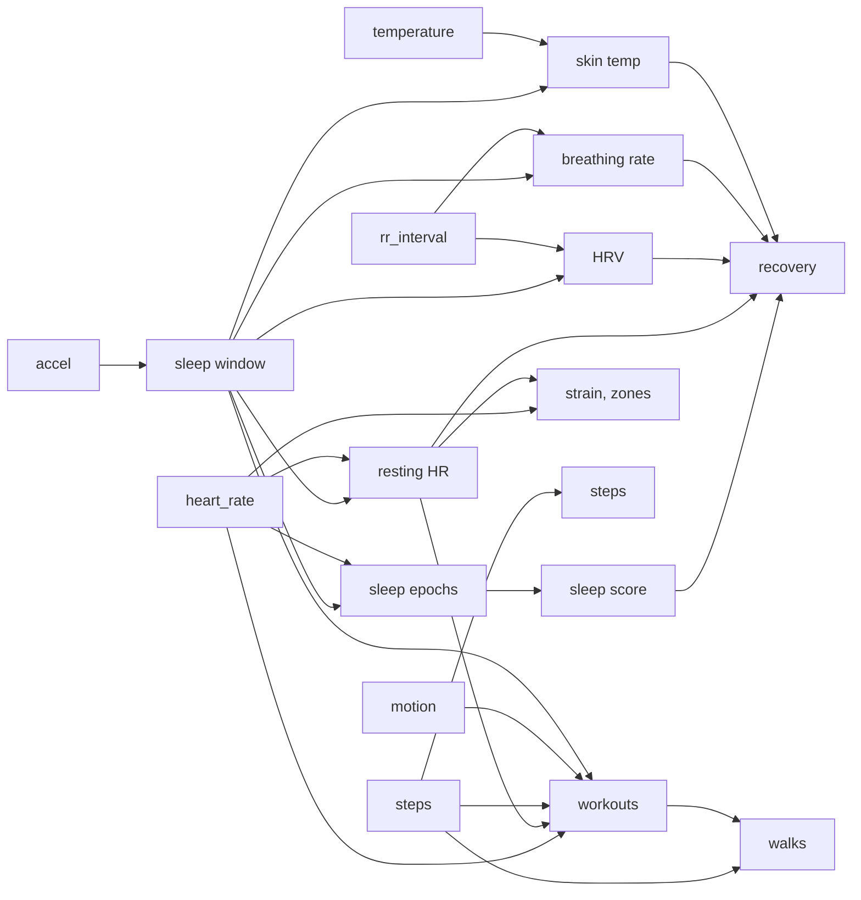

# Health metrics

How the server turns raw strap data into the numbers in your daily note. The code is in
`src/health/metrics/`, one file per idea, and every constant there has a comment saying where it
comes from. The longer explanations, with worked examples, are in the
[Health metric algorithms plan](https://claude.ai/artifact/7nYauS8aMi84xLQfXFXxbu).

Everything that compares you with "normal" uses your own history, never population averages.

## Sleep window (`sleep.ts`)

**Why it works.** Asleep, you change posture only now and then. Awake in bed, you shift a lot.

**How.** The van Hees method (GGIR's "HDCZA"), made for a wrist sensor's once-a-second gravity
reading, which is what the strap gives us:

1. Arm angle each second: `angle = atan(z / √(x² + y²))`, in degrees.
2. Mean angle per 5 seconds, then the absolute change between consecutive 5-second steps.
3. A 5-minute rolling median of those changes, so one twitch doesn't count as waking.
4. Threshold = 15 × the night's 10th percentile, kept between 0.13° and 0.5°. Below it is "still".
5. Still stretches of 30+ minutes, joined when under an hour apart. The longest is the window.

The search runs from 6 pm the day before to 2 pm on the day. This finds when you lay down and got
up. Whether you were actually asleep inside it is the next step. You wear the strap on the bicep,
which moves less than a wrist, so the threshold may need tuning once we see real nights.

## Asleep or awake, 30 seconds at a time (`sleep-epochs.ts`)

**Why it works.** Stillness alone overcounts sleep, because you can lie still and be awake. Waking
also shows in the heart. Every arousal from sleep comes with a burst of sympathetic activity
that lifts heart rate for a few beats to a minute, even if you don't move. Lying awake keeps
heart rate above your sleeping level for as long as you're awake.

**How.** The window is split into 30-second epochs, the sleep lab's unit. An epoch is **awake** if
any of these holds:

1. **Posture change:** the arm angle moved more than 5° between 5-second steps (van Hees 2015's
   definition of a real movement).
2. **Arousal:** the epoch's HR is 8+ bpm above the median of the 10 minutes around it.
3. **Lying awake:** the epoch's HR is 20%+ above the night's sleeping level (its 10th percentile).
   REM sleep raises HR too, but typically by 5–10%, so it stays under this line.
4. **No HR at all:** the strap was off or lost contact. That time doesn't count as sleep.

Then flickers are cleaned up as in sleep-lab rescoring (Webster 1982). A lone awake epoch between
sleep becomes sleep, and a lone sleep epoch between awake ones becomes awake.

From the epochs:
- **Sleep onset** is the first 10 minutes of unbroken sleep.
- **Latency** is the time from lying down to onset.
- **Wake after onset** (WASO) is the awake time after onset.
- **Awakenings** are awake runs of a minute or more.
- **Efficiency** is asleep ÷ the window.

## Sleep score (`sleep-score.ts`)

A 0–100 score with three parts. Each one uses your own nights.

1. **Sufficiency (60%):** asleep ÷ sleep need, capped at 100. This is what Whoop calls sleep
   performance.
   - The **base need** is 8 h, the middle of the 7–9 h adults need (AASM). Set `sleep_need_h` in
     `profile.md` to change it.
   - **Debt:** a third of the last three nights' shortfall is added back, up to an hour.
2. **Efficiency (20%):** 65% efficiency scores 0 and 95% scores 100, linear in between.
3. **Consistency (20%):** how close tonight's sleep onset and wake times are to your average over
   the last 7 nights. 0 minutes off scores 100, and 90 minutes off (averaged over onset and wake)
   scores 0. This part needs 3 nights of history, and until then its weight moves to the other two.
   Regular timing matters: a 2024 UK Biobank study found sleep regularity predicted death risk
   better than sleep duration.

Example: you slept 6 h of an 8 h need (sufficiency 75), at 88% efficiency (77), with sleep onset on
time and waking an hour early (consistency 67). That gives 0.6 × 75 + 0.2 × 77 + 0.2 × 67 = **74**.

## Resting heart rate (`heart-rate.ts`)

**Why it works.** A fitter heart pumps more blood per beat, so it needs fewer beats at rest.
Illness, alcohol, heat and hard training push it up.

**How.** Heart rate during the sleep window, averaged per minute, then as rolling 5-minute means.
Resting HR is the 10th percentile of those means: one of your calmest stretches, without trusting
the single lowest value.

## HRV (`hrv.ts`)

**Why it works.** The vagus nerve slows the heart within a single beat, so when it's in charge
(rested, recovered) consecutive beat gaps differ a little more. Stress, illness and poor sleep
hand control to the slower sympathetic system, and the jitter shrinks.

**How.**

1. **Clean the beat gaps.** Drop gaps outside 300–2000 ms, and any gap more than 20% away from
   the median of its 11-beat neighbourhood (a missed or extra beat).
2. **Successive differences.** Only between kept gaps that really follow each other.
3. **RMSSD** per 5-minute window: `√(mean of squared differences)`. A window counts if at least 80%
   of its beats survived and it has 60+ of them.
4. The night's HRV is the **median window**. `ln(RMSSD)` is what goes into recovery, because HRV
   is skewed: 20 → 30 ms is as big a change as 60 → 90 ms.

Example: gaps 1000, 1040, 980, 1010, 990 ms give differences +40, −60, +30, −20, squares 1600,
3600, 900, 400, mean 1625, and RMSSD = √1625 = **40.3 ms**.

## Breathing rate (`breathing.ts`)

**Why it works.** Breathing in eases the vagal brake and the heart speeds up; breathing out slows
it (respiratory sinus arrhythmia). The beat gaps rise and fall once per breath.

**How** (after Natarajan et al. 2021, Fitbit):

1. In each good 5-minute HRV window, resample the gaps evenly at 4 Hz (beats are uneven in time).
2. Remove the straight-line trend, and taper the ends (Hann window).
3. Fourier transform: how strong each frequency between 0.1 and 0.5 Hz (6–30 breaths/min) is.
4. Average the windows' spectra over the night and take the tallest peak. Keep it only if it is at
   least 2.5× the band's median power.
5. Breaths per minute = peak frequency × 60. A 0.24 Hz peak is 14.4 breaths/min.

## Skin temperature (`skin-temp.ts`)

**Why it works.** Asleep, your body dumps heat through the skin, so skin warms. Fever, alcohol and
the menstrual cycle shift it, and so do the room and bedding, so only the change from your normal
means much.

**How.** The median during sleep, skipping the first 30 minutes while it settles. The deviation
is tonight minus the mean of your last 30 nights (once there are 7).

## Strain and zones (`strain.ts`, `heart-rate.ts`)

**Why it works.** Heart rate rises with effort, but the body's cost rises faster than linearly:
past a point, lactate and stress hormones climb exponentially.

**How** (Banister's TRIMP, 1991):

1. For each minute of the day: heart-rate reserve `HRR = (HR − resting) / (max − resting)`.
2. Minutes under 30% HRR don't count. Others add `HRR × 0.64 × e^(1.92 × HRR)` (women: 0.86 and
   1.67, fitted to the blood-lactate curve).
3. `Strain = 21 × (1 − e^(−TRIMP / 100))`, so each extra point is harder to earn.

Resting HR is last night's. Max HR is `hr_max_measured` from `profile.md` if you've set it,
otherwise `208 − 0.7 × age` (Tanaka 2001). Without a birth date or measured max there is no strain.

Example: a 45-minute run at 150 bpm (resting 55, max 190) is HRR 0.70, weight 2.45, 1.72 a minute,
77 for the run. Add an hour's walk at 100 bpm (0.40 a minute, 24) and the day's TRIMP is about 101:
strain **13.4**.

**Zones** are minutes at 50–60, 60–70, 70–80, 80–90 and 90%+ of max HR.

## Steps (`steps.ts`)

The strap's counter is cumulative and 16-bit, so it wraps at 65,536 and resets when the strap
restarts. We add up the increases, treat a drop from near the top as a wrap and any other drop as
a reset, and ignore jumps of more than 5 steps a second. healthstrap inferred this field's meaning,
so treat steps as provisional.

## Workouts (`workouts.ts`)

**Why it works.** A workout is effort you keep up: heart rate well above your own normal for a
while, or up while you move, with breaks no longer than a rest between sets or games. Cardio gets
hard. Lifting usually doesn't: on 8 November it passed half of heart-rate reserve for one minute.
What lifting has instead is a rhythm: HR spikes with each set and calms in the rest after it, again
and again. What kind of workout it is shows in how you step and move. Running is a steady fast
stride. Volleyball is stop-and-go: short shuffles, bursts of hard movement, breaks between rallies.
Lifting is standing in place, spiking and calming.

The strap only gives a step counter and a motion intensity about once a second. That is enough to
name a whole session, but not to count reps or tell a spike from a block. Published rep counting
(RecoFit, Morris et al. 2014) and volleyball action recognition (Kautz et al. 2017) use raw
accelerometer and gyroscope data at 25–100 Hz.

**How.**

1. **Your baseline.** The 25th percentile of the day's awake minutes, mostly sitting even on an
   active day: 76 bpm on 8 November. Not a fixed level, and not a share of reserve.
2. **Find efforts.** A minute is active 20 bpm above the baseline, or 8 above it with motion of
   0.08 or more, or when a big HR climb (below) peaks in it. Active minutes join across rests of up
   to 5 minutes. Last night's sleep doesn't count.
3. **Big climbs.** Once-a-second HR, averaged per 5 seconds and smoothed over 15. Each peak's climb
   is its rise from the lowest point in the 90 seconds before; peaks within a minute keep the
   bigger. A big climb is 25 bpm or more. Sitting still has climbs of 10 bpm several times every
   10 minutes from ordinary swings, but rarely of 25; a lifting set is 30–58.
4. **Keep real workouts**, of at least 15 minutes with a median motion of 0.02 or more (a strap
   that isn't moving can't be exercising: high HR from a still strap is an optical glitch), that
   are either:
   - **hard:** 5+ minutes at 50% of heart-rate reserve. HR lags effort both ways, taking a minute
     or two to climb and many more to settle, often while you walk away, so a hard workout runs
     from its first to its last hard minute or burst of motion (below). A spike in the warm-up or
     the recovery doesn't stretch it. Untrimmed, the slow recovery stretched the confirmed 2
     November volleyball from 21:15 to 21:28.
   - or **spiking and calming:** failing that, trimmed to its big climbs as well, with at least 6
     of them and at least 2 every 10 minutes.
5. **Name it**, checking in this order, per minute of the workout:
   - **Running:** half the minutes at 140+ steps a minute. Running is rarely slower.
   - **Walking:** half the minutes at 90+ steps a minute (brisk walking is 100–130, Tudor-Locke
     2018).
   - **Volleyball:** 30%+ of minutes at 20–89 steps a minute, and 20%+ with motion of 0.35 or
     more, a burst of play. Brisk walking reads 0.25–0.33 on the bicep.
   - **Lifting:** spiking and calming, with 60%+ of minutes under 20 steps a minute and under 20%
     bursts.
   - Anything else is **workout**.
6. Each workout gets its own TRIMP and strain, the same way as the day's.

Checked on the first weeks of data: volleyball on 2 November, 20:30–21:15 (confirmed), and lifting
on 8 November, 18:06–18:51 (matching the note's log), with no other sessions except an unnamed
hard afternoon on 14 October and a possible lifting session on 4 November, 18:07–18:31, neither
confirmed. No run has been recorded yet, so the running rule rests on published cadences alone.
Treat the names as provisional until they have been checked against more sessions.

## Lifting sets (`sets.ts`, `lifting.ts`)

**Why it works.** A set lifts heart rate for 30–60 seconds, and the rest after it lets it fall,
so each set is a climb. You rest between sets, not between exercises, so moving to the next exercise
looks like any other rest. The log in the daily note says how many sets there were and in what
order, which is everything else that's needed: no times.

**How.**

1. Read the log (see [vault format](vault-format.md)) and expand it into sets, in order.
2. Find the day's lifting session: the longest workout named lifting, or else the longest unnamed
   one. Failing both, it is the longest stretch of **moving in place**: minutes with motion of 0.06
   or more and under 20 steps, joined across rests of up to 5 minutes, at least 15 minutes long,
   outside sleep, workouts and walks.
3. In that session, average the once-a-second HR per 5 seconds and smooth it over 15. Minute
   averages, which the workout search uses, blur a 45-second set away.
4. Every peak's climb is its rise from the lowest point in the 90 seconds before it. Climbs under
   6 bpm are noise.
5. Take the N clearest climbs at least a minute apart, where N is the number of logged sets, and
   give them to the sets in order. With fewer than N clear climbs nothing is matched, rather than
   pinning a set to a moment the data can't support. The log is still counted.

On 8 November (4 exercises, 15 sets, logged without times) the session was found as lifting,
18:06–18:51, and the 15 clearest climbs ran from the first warm-up at 18:06 to 18:50, a minute
before the last set was written down. There were about 20 set-like climbs, so which ones are the
sets in the middle is the clearest-first guess; more logged sessions will show how good it is.

Volume is weight × reps over every set, in pounds (kg × 2.20462).

## Walks (`walks.ts`)

**Why it works.** Walking is light effort, so it rarely lifts heart rate enough to be a workout, but
it shows plainly in the step counter: a minute after minute of steady stepping.

**How**, from the step counter alone, so it works without a profile:

1. A minute is walking at 60+ steps. Slower than that is pottering around the house.
2. Walking minutes join across stops of up to 3 minutes, such as crossings and traffic lights.
3. A walk lasts at least 10 minutes, the classic activity bout.
4. Time in a workout or asleep isn't a walk, so walking to the court is a walk and the game isn't.

Each walk has its steps (stops included), its median cadence, and its **brisk minutes**: minutes at
100+ steps, which is moderate intensity, about 3 METs (Tudor-Locke et al. 2018, CADENCE-Adults).

## Recovery (`recovery.ts`)

**Why it works.** When your body has absorbed yesterday's stress, the vagal system is back in
charge overnight: HRV at or above your normal, resting HR at or below it, breathing and temperature
steady.

**How.**

1. z-score each input against your last 60 nights: `z = (tonight − mean) / SD`. Needs 14 nights.
2. Combine, with HRV dominant and good pointing up:
   `c = 0.50 z_HRV − 0.25 z_RHR + 0.15 z_sleep − 0.10 max(0, z_breathing − 1) − 0.5 max(0, temp_dev − 0.3)`

   `z_sleep` is the sleep score against your own last 60 nights, so one bad night counts the same
   whether your normal is 70 or 90.
3. `Recovery = 100 × Φ(c / σc)`, where Φ is the normal curve's cumulative share and σc is how
   much c varies across your recent nights. An ordinary night lands near 50%.

Bands: red under 34, yellow 34–66, green 67 and up. The weights are a starting guess, kept in a
versioned params file and tuned against your morning check-ins: see [the feedback loop](health-feedback.md).

Should sleep count toward recovery at all? Whoop, Oura and Garmin include it. HRV4Training keeps
recovery to physiology only, because a short night already shows up in HRV and resting HR. We
include it at a small weight. Sleep loss hurts performance and judgment beyond what HRV shows, and
because z_sleep compares against your own normal, the double counting stays small.
