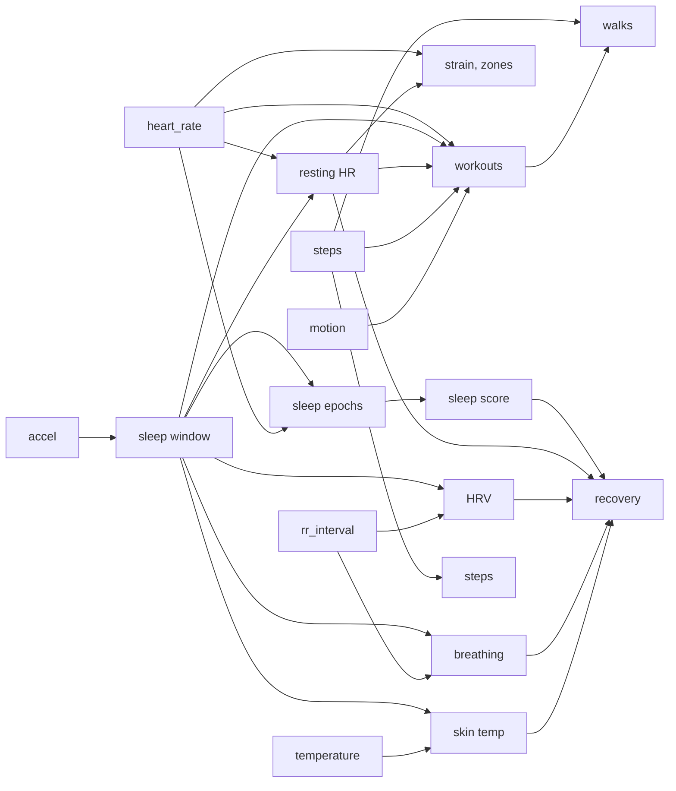

# Health metrics

How raw strap data becomes the numbers in the daily note. Code: `src/health/metrics/`, one file
per idea; each constant has a comment citing its source. Longer explanations with worked
examples: https://claude.ai/artifact/7nYauS8aMi84xLQfXFXxbu. Everything that compares you with
"normal" uses your own history, never population averages.

## Sleep window (`sleep.ts`)

Van Hees (GGIR "HDCZA") on once-a-second gravity: arm angle `atan(z / √(x² + y²))`, mean per 5 s,
absolute change between steps, 5-minute rolling median. Still = below 15 × the night's 10th
percentile, clamped to 0.13°–0.5°. Still stretches of 30+ min, joined when under an hour apart;
the longest, searched 18:00 the day before to 14:00, is the window. The strap is worn on the
bicep, so the threshold may need tuning.

## Sleep epochs (`sleep-epochs.ts`)

30-second epochs in the window. Awake if any: posture moved over 5° between 5-second steps; HR 8+
bpm above the median of the surrounding 10 min (arousal); HR 20%+ above the night's 10th
percentile (lying awake; REM stays under this); no HR. Lone flips are rescored to match their
neighbours (Webster 1982). Onset is the first 10 min of unbroken sleep; latency, WASO, awakenings
(awake runs of 1+ min) and efficiency (asleep ÷ window) follow.

## Sleep score (`sleep-score.ts`)

- **Sufficiency 60%:** asleep ÷ need, capped at 100. Need is 8 h (`sleep_need_h` in `profile.md`)
  plus a third of the last three nights' shortfall, up to an hour.
- **Efficiency 20%:** 65% scores 0, 95% scores 100, linear.
- **Consistency 20%:** onset and wake against the last 7 nights' average; 0 min off is 100, 90 min
  is 0. Needs 3 nights; until then its weight goes to the others.

## Resting HR (`heart-rate.ts`)

Per-minute HR in the sleep window, rolling 5-minute means, 10th percentile.

## HRV (`hrv.ts`)

Drop RR gaps outside 300–2000 ms or 20%+ from their 11-beat median. Successive differences only
between consecutive kept gaps. RMSSD per 5-minute window (80%+ of beats kept, 60+ beats). The
night is the median window; recovery uses `ln(RMSSD)`.

## Breathing rate (`breathing.ts`)

After Natarajan 2021: each good HRV window resampled at 4 Hz, detrended, Hann-tapered, FFT over
0.1–0.5 Hz. Average the night's spectra; the tallest peak counts if 2.5× the band's median power.
Breaths/min = peak Hz × 60.

## Skin temperature (`skin-temp.ts`)

Median during sleep after the first 30 min. Deviation is against the last 30 nights' mean (once
there are 7).

## Strain and zones (`strain.ts`)

Banister TRIMP per minute: `HRR = (HR − rest) / (max − rest)`; minutes under 0.3 don't count;
others add `HRR × 0.64 × e^(1.92 × HRR)` (women 0.86, 1.67). `Strain = 21 × (1 − e^(−TRIMP/100))`.
Rest is last night's resting HR, else the past week's median, else the closest night within a
week (earlier first). Max is `hr_max_measured`, else `208 − 0.7 × age` (Tanaka); no birth date
means no strain. Zones: minutes at 50–60, 60–70, 70–80, 80–90, 90%+ of max.

## Steps (`steps.ts`)

The counter is cumulative and 16-bit: sum increases, treat a drop from near 65,536 as a wrap and
any other drop as a reset, ignore over 5 steps/s. The field's meaning was inferred by
healthstrap, so steps are provisional.

## Workouts (`workouts.ts`)

1. **Baseline:** the 25th percentile of the day's awake minutes.
2. **Active minute:** 20+ bpm over baseline, or 8+ with motion ≥ 0.08, or a big climb peaks in
   it. Joined across rests up to 5 min; sleep excluded.
3. **Big climb:** HR per 5 s smoothed over 15 s; rise from the lowest point in the prior 90 s;
   peaks within a minute keep the bigger; 25+ bpm counts (a lifting set is 30–58).
4. **Keep** 15+ min with median motion ≥ 0.02 (a still strap with high HR is an optical glitch)
   that is either **hard** (5+ min at 50% HRR, trimmed to its first and last hard minute or burst)
   or **spiking and calming** (trimmed to its climbs; 6+ climbs, 2+ per 10 min).
5. **Name**, in order: running (half the minutes at 140+ steps/min), walking (half at 90+),
   volleyball (30%+ at 20–89 steps and 20%+ with motion ≥ 0.35), lifting (spiking and calming,
   60%+ under 20 steps, under 20% bursts), else workout.
6. Each gets its own TRIMP and strain.

Checked against only a few sessions, and no runs yet, so names are provisional. Uncertain ones
are `POSSIBLE` and asked about on the Activity page.

## Lifting sets (`sets.ts`, `lifting.ts`)

1. Expand the daily note's log into sets in order ([vault-format.md](vault-format.md)).
2. The session: the longest lifting workout, else the longest unnamed one, else the longest
   stretch of moving in place (motion ≥ 0.06, under 20 steps, joined across 5 min, 15+ min,
   outside sleep, workouts and walks).
3. HR per 5 s smoothed over 15 s; each peak's climb from the lowest point in the prior 90 s;
   under 6 bpm is noise.
4. The N clearest climbs at least a minute apart go to the N sets in order. Fewer than N clear
   climbs: nothing is matched (the log still counts).

Volume is weight × reps, in pounds.

## Walks (`walks.ts`)

From steps alone: minutes at 60+ steps, joined across stops up to 3 min, 10+ min long, outside
workouts and sleep. Each has steps, median cadence and brisk minutes (100+ steps, about 3 METs).

## Recovery (`recovery.ts`)

1. z-score each input against the last 60 nights (needs 14).
2. `c = 0.50 z_HRV − 0.25 z_RHR + 0.15 z_sleep − 0.10 max(0, z_breathing − 1) − 0.5 max(0, temp_dev − 0.3)`;
   `z_sleep` is the sleep score against your own 60 nights.
3. `Recovery = 100 × Φ(c / σc)`, σc from recent nights, so an ordinary night is near 50%.

Bands: red under 34, yellow 34–66, green 67+. Sleep counts at a small weight (as Whoop, Oura and
Garmin do). The weights are versioned params tuned against check-ins
([health-feedback.md](health-feedback.md)).

## Still to build

Training load, calories, VO2max, fitness and biological age, and sleep stages: planned in
[health-extended.md](health-extended.md).
