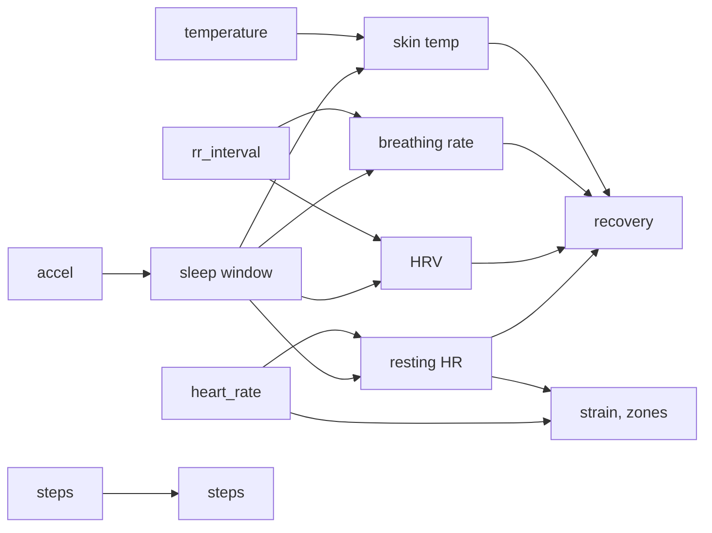

# Health metrics

How the server turns raw strap data into the numbers in your daily note. The code is in
`src/health/metrics/`, one file per idea, and every constant there has a comment saying where it
comes from. The longer explanations, with worked examples, are in the
[Health metric algorithms plan](https://claude.ai/artifact/7nYauS8aMi84xLQfXFXxbu).

Everything that compares you with "normal" uses your own history, never population averages.

## Sleep window (`sleep.ts`)

**Why it works.** Asleep, you change posture only now and then. Awake in bed, you shift a lot.

**How.** The van Hees method (GGIR's "HDCZA"), made for a wrist sensor's once-a-second gravity
reading, which is what the strap gives us:

1. Arm angle each second: `angle = atan(z / √(x² + y²))`, in degrees.
2. Mean angle per 5 seconds, then the absolute change between consecutive 5-second steps.
3. A 5-minute rolling median of those changes, so one twitch doesn't count as waking.
4. Threshold = 15 × the night's 10th percentile, kept between 0.13° and 0.5°. Below it is "still".
5. Still stretches of 30+ minutes, joined when under an hour apart. The longest is the window.

The search runs from 6 pm the day before to 2 pm on the day. **Asleep** is the still time inside
the window, and **efficiency** is asleep ÷ window. You wear the strap on the bicep, which moves less
than a wrist, so the threshold may need tuning once we see real nights.

## Resting heart rate (`heart-rate.ts`)

**Why it works.** A fitter heart pumps more blood per beat, so it needs fewer beats at rest.
Illness, alcohol, heat and hard training push it up.

**How.** Heart rate during the sleep window, averaged per minute, then as rolling 5-minute means.
Resting HR is the 10th percentile of those means: one of your calmest stretches, without trusting
the single lowest value.

## HRV (`hrv.ts`)

**Why it works.** The vagus nerve slows the heart within a single beat, so when it's in charge
(rested, recovered) consecutive beat gaps differ a little more. Stress, illness and poor sleep
hand control to the slower sympathetic system, and the jitter shrinks.

**How.**

1. **Clean the beat gaps.** Drop gaps outside 300–2000 ms, and any gap more than 20% away from
   the median of its 11-beat neighbourhood (a missed or extra beat).
2. **Successive differences.** Only between kept gaps that really follow each other.
3. **RMSSD** per 5-minute window: `√(mean of squared differences)`. A window counts if at least 80%
   of its beats survived and it has 60+ of them.
4. The night's HRV is the **median window**. `ln(RMSSD)` is what goes into recovery, because HRV
   is skewed: 20 → 30 ms is as big a change as 60 → 90 ms.

Example: gaps 1000, 1040, 980, 1010, 990 ms give differences +40, −60, +30, −20, squares 1600,
3600, 900, 400, mean 1625, and RMSSD = √1625 = **40.3 ms**.

## Breathing rate (`breathing.ts`)

**Why it works.** Breathing in eases the vagal brake and the heart speeds up; breathing out slows
it (respiratory sinus arrhythmia). The beat gaps rise and fall once per breath.

**How** (after Natarajan et al. 2021, Fitbit):

1. In each good 5-minute HRV window, resample the gaps evenly at 4 Hz (beats are uneven in time).
2. Remove the straight-line trend, and taper the ends (Hann window).
3. Fourier transform: how strong each frequency between 0.1 and 0.5 Hz (6–30 breaths/min) is.
4. Average the windows' spectra over the night and take the tallest peak. Keep it only if it is at
   least 2.5× the band's median power.
5. Breaths per minute = peak frequency × 60. A 0.24 Hz peak is 14.4 breaths/min.

## Skin temperature (`skin-temp.ts`)

**Why it works.** Asleep, your body dumps heat through the skin, so skin warms. Fever, alcohol and
the menstrual cycle shift it, and so do the room and bedding, so only the change from your normal
means much.

**How.** The median during sleep, skipping the first 30 minutes while it settles. The deviation
is tonight minus the mean of your last 30 nights (once there are 7).

## Strain and zones (`strain.ts`, `heart-rate.ts`)

**Why it works.** Heart rate rises with effort, but the body's cost rises faster than linearly:
past a point, lactate and stress hormones climb exponentially.

**How** (Banister's TRIMP, 1991):

1. For each minute of the day: heart-rate reserve `HRR = (HR − resting) / (max − resting)`.
2. Minutes under 30% HRR don't count. Others add `HRR × 0.64 × e^(1.92 × HRR)` (women: 0.86 and
   1.67, fitted to the blood-lactate curve).
3. `Strain = 21 × (1 − e^(−TRIMP / 100))`, so each extra point is harder to earn.

Resting HR is last night's. Max HR is `hr_max_measured` from `profile.md` if you've set it,
otherwise `208 − 0.7 × age` (Tanaka 2001). Without a birth date or measured max there is no strain.

Example: a 45-minute run at 150 bpm (resting 55, max 190) is HRR 0.70, weight 2.45, 1.72 a minute,
77 for the run. Add an hour's walk at 100 bpm (0.40 a minute, 24) and the day's TRIMP is about 101:
strain **13.4**.

**Zones** are minutes at 50–60, 60–70, 70–80, 80–90 and 90%+ of max HR.

## Steps (`steps.ts`)

The strap's counter is cumulative and 16-bit, so it wraps at 65,536 and resets when the strap
restarts. We add up the increases, treat a drop from near the top as a wrap and any other drop as
a reset, and ignore jumps of more than 5 steps a second. healthstrap inferred this field's meaning,
so treat steps as provisional.

## Recovery (`recovery.ts`)

**Why it works.** When your body has absorbed yesterday's stress, the vagal system is back in
charge overnight: HRV at or above your normal, resting HR at or below it, breathing and temperature
steady.

**How.**

1. z-score each input against your last 60 nights: `z = (tonight − mean) / SD`. Needs 14 nights.
2. Combine, with HRV dominant and good pointing up:
   `c = 0.50 z_HRV − 0.25 z_RHR − 0.10 max(0, z_breathing − 1) − 0.5 max(0, temp_dev − 0.3)`
3. `Recovery = 100 × Φ(c / σc)`, where Φ is the normal curve's cumulative share and σc is how
   much c varies across your recent nights. An ordinary night lands near 50%.

Bands: red under 34, yellow 34–66, green 67 and up. The weights are a starting guess. Sleep
performance (0.15 in the plan) joins once there is a sleep-need model.
