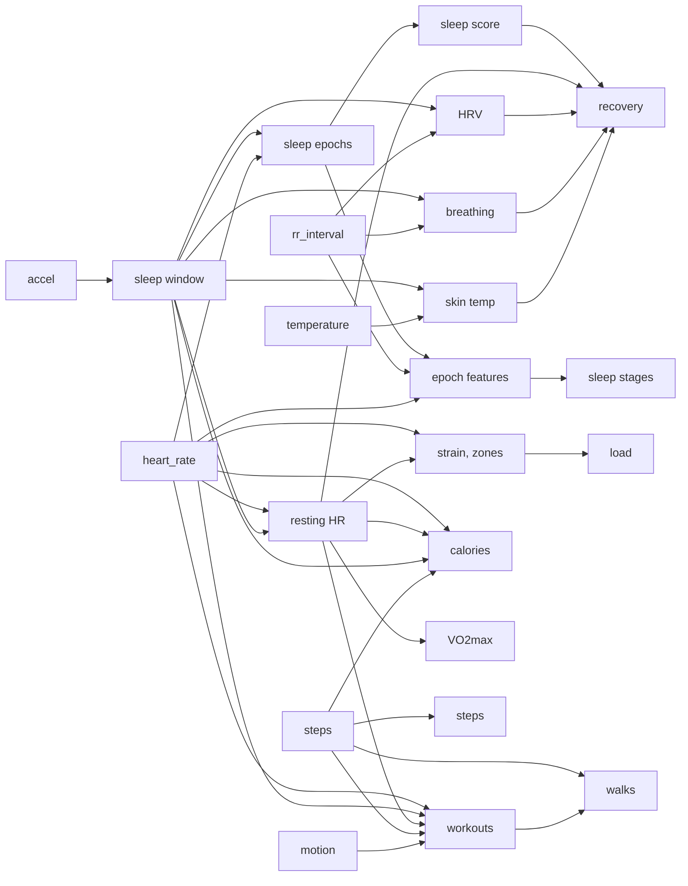

# Health metrics

How raw strap data becomes the numbers in the daily note. Code: `src/health/metrics/`, one file
per idea; each constant has a comment citing its source. A primer for readers new to all of
it, with formulas, papers and worked examples: [health-primer.html](health-primer.html)
([how to keep it current](development.md#health-primer)). Everything that compares you with
"normal" uses your own history, never population averages; VO2max is the exception, since it is
a comparison with other people by definition.

## Sleep window (`sleep.ts`)

Van Hees (GGIR "HDCZA") on once-a-second gravity: arm angle `atan(z / √(x² + y²))`, mean per 5 s,
absolute change between steps, 5-minute rolling median. Still = below 15 × the night's 10th
percentile, clamped to 0.13°–0.5°. Still stretches of 30+ min, joined when under an hour apart;
the longest, searched 18:00 the day before to 14:00, is the window. The strap is worn on the
bicep, so the threshold may need tuning.

## Sleep epochs (`sleep-epochs.ts`)

30-second epochs in the window. Awake if any: posture moved over 5° between 5-second steps; HR 8+
bpm above the median of the surrounding 10 min, or 20%+ above the night's 10th percentile
(arousal); no HR. Lone flips are rescored to match their neighbours (Webster 1982). Onset is the
first 10 min of unbroken sleep, and latency follows from it.

This decides awake only up to onset. After it, the stage model decodes awake with the other
stages (algo 16), and asleep time, WASO, awakenings (awake runs of 1+ min) and efficiency (asleep
÷ window) come from its stages. Scored one epoch at a time, a minute of fast beats in REM was an
awakening: on 3–11 Nov that gave 21–39 awakenings a night, and 6–13 REM → awake → REM.

## Sleep stages (`sleep-stages.ts`)

Awake, light, deep and REM for each epoch. Estimated: the HR, movement, HR-cue and transition
parts are fitted to sleep-lab nights; HRV, breathing and DFA α1 are hand-set until `fit-stages.ts` fits them
to your nights ([health-feedback.md](health-feedback.md#fitting-stages-to-you)).

- **Features** (`sleep-features.ts`), per epoch, z-scored against the night's asleep epochs:
  mean HR; `ln(RMSSD)` over the 5 min around it (null under 60 differences; Esco & Flatt 2014);
  breathing regularity, `ln(peak ÷ band median)` of the 2-min spectrum (null under 80% kept
  beats); DFA α1 (below); the largest 5-s arm angle change; whether `sleep-epochs.ts` saw an
  arousal; minutes since onset. HR is then taken against the median of the asleep epochs within
  an hour either side, since it falls across the night whatever the stage.
- **Model:** a 4-state HMM decoded with Viterbi. Before onset awake is `sleep-epochs.ts`'s and
  fixed; after it, awake is decoded like the rest. Per state: a Gaussian on HRV, breathing and
  DFA α1 (null features add nothing), and on HR when there is no arousal; the chance of an HR
  cue (none, an arousal with HR z under 2, 2–4, 4–8 or 8+, or no HR); and the chance of a
  movement of 0.5–2°, 2–5° or over 5°. Sleep stages score the cue and movement against their
  own "none" and "still" (stillness alone would pull every still epoch toward deep); awake
  against light's, since being still is evidence against awake. Jumps are binned, not in the
  HR Gaussian: one Gaussian over both would let its tail decide an HR of 150. Awake has
  light's HRV, breathing and DFA levels: nothing says how it looks in RR.
- **Fitted** (`stage-params.json`, by `src/health/train-stages.ts`): the HR Gaussians, the
  cue and movement chances, and the transitions, one matrix before onset and one per 30 min since,
  each leaning on the night-wide matrix as if it had 100 more epochs. The time of night (deep
  early, REM later) is in those matrices. REM can't start before 45 min: the lab nights had it
  there on one night of 30.
- **Hand-set** by default: HRV (deep +0.8, REM −0.6), breathing (deep +0.8, REM −0.8) and DFA
  α1 (deep −0.6, REM +0.5), SD 0.8 (Fonseca 2017, Gutierrez 2016, Bunde 2000, Penzel 2003). The
  lab data has no RR, so nothing has checked HRV and breathing.
- **DFA α1** (`dfa.ts`): how correlated the gaps are over 4–16 beats, the slope of log F(n)
  against log n after detrending each box of the integrated series (Peng 1995; the same range as
  Rogers 2021). About 0.5 is uncorrelated, 1.0 is 1/f. Per epoch, over the longest run of clean
  beats in the 5 min around it, null under 100 beats (6+ boxes at 16). A single dropped gap is
  left out and the run goes on; two in a row, or a missing beat (as HRV below finds it), end
  it. 77–96% of asleep epochs get a value (64–92% without bridging).
- **DFA check**, on 4–9 Nov without lab labels: mean α1 0.76 in epochs H12 decodes deep, 0.86
  light and 1.15 REM; 0.83 in the first 90 min against 1.01 in the last 2 h; r −0.15 with
  `hrvZ`, so it adds something HRV doesn't. It is weighted. Shares (L/D/R) without and with it:
  40/27/33 → 42/26/31, 69/11/20 → 62/14/24, 46/22/32 → 37/29/34, 53/25/22 → 45/26/30,
  64/17/19 → 58/20/22, 59/21/20 → 45/30/25; the 5 Nov night stops being unusual.
- **Plausible** when light is 33–61%, deep 2–48% and REM 5–51% of asleep time; otherwise the
  note line ends "unusual". The bounds are mean ± 1.96 SD of the predicted shares on held-out
  lab nights with 5 h or more asleep, so only nights the model rarely gives are flagged. They
  are wide because the model's own error is.

### Training data and accuracy

Walch O, Huang Y, Forger D, Goldstein C. *Motion and heart rate from a wrist-worn wearable and
labeled sleep from polysomnography*, PhysioNet `sleep-accel` 1.0.0
(https://physionet.org/content/sleep-accel/1.0.0/), under the Open Data Commons Attribution
License (ODC-BY 1.0). Apple Watch acceleration and heart rate with sleep-lab stages per 30 s,
for 31 adults; 30 used (one has HR in 13% of epochs). Not checked in.

`train-stages.ts` makes the watch look like the strap: acceleration averaged to a 1 Hz gravity
vector, HR interpolated to 1 Hz (gaps over 60 s stay gaps). Then it runs our own code over the
lab's scored span (lights off to lights on, so every epoch has a label): `scoreEpochs`,
`epochFeatures` (no RR, so HRV and breathing are null), the HR detrend. N1+N2 are light, N3+N4
deep. Everything is fitted to what the decoder can say: after onset each epoch counts as the
lab's stage, awake included; before it, our awake epochs count as awake and our asleep ones as
the lab's sleep stage, lab wake as light.

Leave one subject out, pooled over 25,828 held-out epochs:

| Model | Accuracy | κ | κ W/N/R | Wake | Light | Deep | REM | Wake spec. | Shares (L/D/R) |
| --- | --- | --- | --- | --- | --- | --- | --- | --- | --- |
| Awake decoded (16) | 56% | 0.34 | 0.46 | 38% | 55% | 55% | 66% | 95% | 46 / 29 / 25 |
| Awake fixed, same fit | 54% | 0.30 | 0.40 | 40% | 61% | 51% | 44% | 90% | 56 / 26 / 18 |
| Awake fixed, algo 15 | 52% | 0.28 | 0.40 | 40% | 55% | 56% | 46% | 90% | 51 / 31 / 19 |
| H9 hand-set | 51% | 0.19 | 0.33 | 40% | 69% | 6% | 38% | 90% | 70 / 12 / 18 |
| Lab | | | | | | | | | 60 / 16 / 23 |

Recall per stage. Decoding awake mostly stops REM being called awake: 19% of lab REM epochs
have an HR arousal. Wake bouts per night between first and last sleep, decoded against fixed:
8.8 against 20.4 (3.0 against 10.7 of a minute or less), WASO 29 against 49 min; the lab has
14.9 (11.7) and 21 min, so most of its bouts are a minute or less, and those are rarely seen. Webster
1982 rescoring on top (the first minute of wake after 4 min of sleep is sleep) cut wake recall
to 31% and κ to 0.33, so it isn't used. In this data deep HR is steadier than light's, not
lower, so the HR Gaussian for deep is narrow rather than shifted. Walch 2019 reports κ
0.13–0.30 for wake/NREM/REM from the same watch with motion and HR; ours is above that, and the
4-class κ is in the 0.3–0.5 usual for HR and motion.

On 3–11 Nov (no labels), algo 15 → 16: awakenings 21–39 → 6–23 a night (mean 32 → 16), of a
minute or less 12–26 → 2–8, WASO 28–91 → 16–90 min (mean 62 → 53), REM → awake → REM 6–13 →
0–1; shares 47/25/28 → 43/25/31. Long awakenings stay: of 43 min of HR up to 166 from 02:05 on
4 Nov, 28 stay awake and the middle 15, at 64–114 bpm, read as REM.

## Sleep score (`sleep-score.ts`)

- **Sufficiency 60%:** asleep ÷ need, capped at 100. Need is 8 h (`sleep_need_h` in `Profile.md`)
  plus a third of the last three nights' shortfall, up to an hour.
- **Efficiency 20%:** 65% scores 0, 95% scores 100, linear.
- **Consistency 20%:** onset and wake against the last 7 nights' average; 0 min off is 100, 90 min
  is 0. Needs 3 nights; until then its weight goes to the others.

## Resting HR (`heart-rate.ts`)

Per-minute HR in the sleep window, rolling 5-minute means, 10th percentile.

## HRV (`hrv.ts`)

Drop RR gaps outside 300–2000 ms or 20%+ from their 11-beat median. Successive differences only
between consecutive kept gaps, and not when one is 20%+ off the one before (an ectopic beat,
Malik 1989). RMSSD per 5-minute window (80%+ of beats kept, 60+ beats). The night is the median
window; recovery uses `ln(RMSSD)`.

The strap stamps each 1-second packet to the whole second and counts its beats back from that,
so a beat happened up to a second before its stamp, and its gaps sum about 2.4% short of the
clock. `continuityBreaks` tracks the span each beat could have happened in, its gap after the
last beat's span, cut to what its stamp allows; an empty span means a beat is missing. Until
algo 13 a beat had to land within 150 ms of where the last gap put it: on 4–9 Nov that used
70–87% of asleep beats, now 84–98%, and moved RMSSD by −1.9 to +0.8 ms.

## Breathing rate (`breathing.ts`)

After Natarajan 2021: each good HRV window resampled at 4 Hz, detrended, Hann-tapered, FFT over
0.1–0.5 Hz. Average the night's spectra; the tallest peak counts if 2.5× the band's median power.
Breaths/min = peak Hz × 60.

## Skin temperature (`skin-temp.ts`)

Median during sleep after the first 30 min. Deviation is against the last 30 nights' mean (once
there are 7).

## Strain and zones (`strain.ts`)

Banister TRIMP per minute: `HRR = (HR − rest) / (max − rest)`; minutes under 0.3 don't count;
others add `HRR × 0.64 × e^(1.92 × HRR)` (women 0.86, 1.67). `Strain = 21 × (1 − e^(−TRIMP/100))`.
Rest is last night's resting HR, else the past week's median, else the closest night within a
week (earlier first). Max is `hr_max_measured`, else `208 − 0.7 × age` (Tanaka); no birth date
means no strain. Zones: minutes at 50–60, 60–70, 70–80, 80–90, 90%+ of max.

## Training load (`load.ts`)

From each day's TRIMP in `days/` (strain is squashed, so it can't be averaged). Acute and chronic
are 7- and 28-day exponentially weighted means, `λ = 2 / (N + 1)` (Williams 2017), seeded with the
first day of up to 56. Ratio = acute ÷ chronic.

- **Bands:** under 0.8 easing off, 0.8–1.3 steady, 1.3–1.5 building fast, over 1.5 spike
  (Gabbett 2016). The injury claims for them are disputed (Impellizzeri 2020), so the note says
  "load", never "risk".
- **Gaps:** a day with no row, no TRIMP or under 16 h worn gets the median TRIMP of the well-worn
  days in the 28 before. Days before the first row aren't gaps.
- **Workouts** get their own total: the same minutes summed over the workout (`kcal` in
  `workouts/`).
- **Today** is a running total, so it counts as at least that median until the day ends and is
  never a gap. Otherwise the ratio would sag to about 0.8 every morning.
- **Missing:** no acute with more than 2 gaps in the last 7 days or under 7 days of history; no
  chronic under 28 days; no ratio without both, and then no note line.

## Calories (`calories.ts`)

Per minute of the local day, worn or not, then summed. BMR is Mifflin–St Jeor (1990),
`10 × kg + 6.25 × cm − 5 × age + 5` (women −161), spread over 1,440 minutes.

- **Asleep** (in last night's window): BMR × 0.95.
- **Not worn** (no HR): BMR × 1.2.
- **Awake and worn:** the largest of three.
  - **Sitting:** BMR × 1.2.
  - **Walking**, from the minute's steps (as walks use them): step length 0.415 × height, speed =
    steps × step length, then ACSM's walking equation, `VO2 = 3.5 + 0.1 × m/min` ml/kg/min, at
    5 kcal per litre. Only 60+ steps/min, and speed capped at 100 m/min, the top of the range
    the equation holds for; running is left to HR. Steps are provisional, so this is too.
  - **Heart rate:** Keytel 2005 without VO2max, `−55.0969 + 0.6309 HR + 0.1988 kg + 0.2017 age`
    kJ/min (women `−20.4022 + 0.4472 HR − 0.1263 kg + 0.074 age`), weighed in linearly from none
    at 40% of HR reserve (the flex point, Spurr 1988) to all of it at 60%:
    `sitting + w × max(0, Keytel − sitting)`. No jump at the flex point. Rest and max HR are
    strain's.
- **Active** = total − BMR for the same minutes, never below 0.
- **Today** is a running total of the minutes so far, like strain and steps.
- **Missing:** no weight, height, birth date or sex, or no resting or max HR: no calories. Without
  HR the total would leave out all exercise yet read like a real day.

Keytel likely reads high for light people: 13.4 kcal/min at 150 bpm for a 56 kg man, where MET
tables give about 9 for a steady jog. Its sample's mean mass (115 people, 47–120 kg) isn't in any
source we could read, and the equation already has a weight term, so there is no correction.

## VO2max (`vo2max.ts`)

Uth 2004: `15.3 × max HR ÷ resting HR` ml/kg/min (14.5 for women, Uth 2005). Resting HR is the
median of the last 30 nights, last night included, so it moves as fitness does; under 14 nights
with a reading, none. Needs `hr_max_measured` and `sex`: with Tanaka's predicted max the number
is just age and resting HR again. Note: rounded, "(estimate)"; row: one decimal.

Uth's SEE was 2.7 ml/kg/min, but in 46 well-trained men. In 109 men of mixed fitness it was about
7 (Esco 2012), and the 15 factor read about 2 too high in untrained men (Castagna 2022 found 14.6
for them). A high max for your age raises the ratio without more fitness, so read it as ±10–15%.
No correction is applied: none is general.

Later, with runs or reliable walking speed: extrapolate submaximal HR against speed to max HR,
as watches do.

## Steps (`steps.ts`)

The counter is cumulative and 16-bit: sum increases, treat a drop from near 65,536 as a wrap and
any other drop as a reset, ignore over 5 steps/s. The field's meaning was inferred by
healthstrap, so steps are provisional.

## Workouts (`workouts.ts`)

1. **Baseline:** the 25th percentile of the day's awake minutes.
2. **Active minute:** 20+ bpm over baseline, or 8+ with motion ≥ 0.08, or a big climb peaks in
   it. Joined across rests up to 5 min; sleep excluded.
3. **Big climb:** HR per 5 s smoothed over 15 s; rise from the lowest point in the prior 90 s;
   peaks within a minute keep the bigger; 25+ bpm counts (a lifting set is 30–58).
4. **Keep** 15+ min with median motion ≥ 0.02 (a still strap with high HR is an optical glitch)
   that is either **hard** (5+ min at 50% HRR, trimmed to its first and last hard minute or burst)
   or **spiking and calming** (trimmed to its climbs; 6+ climbs, 2+ per 10 min).
5. **Hard lifting** (hard, then named lifting) is widened over climbs within 5 min of its edge,
   so a warm-up set that wasn't hard still starts it.
6. **Name**, in order: running (half the minutes at 140+ steps/min), walking (half at 90+),
   volleyball (30%+ at 20–89 steps and 20%+ with motion ≥ 0.35), lifting (spiking and calming,
   60%+ under 20 steps, under 20% bursts), else workout.
7. Each gets its own TRIMP and strain.
8. **Strava runs** ([strava.md](strava.md)): a run's window, rounded to the nearest minute,
   replaces any workout it overlaps and is `CONFIRMED` running with its distance. The rest of that
   workout goes back to the walk finder.

Checked against only a few sessions, and no runs yet, so names are provisional. Uncertain ones
are `POSSIBLE` and asked about on the Activity page.

## Lifting sets (`sets.ts`, `lifting.ts`)

1. Expand the daily note's log into sets in order ([vault-format.md](vault-format.md)).
2. The session: the longest lifting workout, else the longest unnamed one, else the longest
   stretch of moving in place (motion ≥ 0.06, under 20 steps, joined across 5 min, 15+ min,
   outside sleep, workouts and walks).
3. HR per 5 s smoothed over 15 s; each peak's climb from the lowest point in the prior 90 s,
   looking before the session for a set that peaks at its start; under 6 bpm is noise.
4. The N clearest climbs at least a minute apart go to the N sets in order. Fewer than N clear
   climbs: nothing is matched (the log still counts).

Volume is weight × reps, in pounds.

## Walks (`walks.ts`)

From steps alone: minutes at 60+ steps, joined across stops up to 3 min, 10+ min long, outside
workouts and sleep (5+ min when it ends or starts within 3 min of a Strava run). Each has steps,
median cadence and brisk minutes (100+ steps, about 3 METs).

## Recovery (`recovery.ts`)

1. z-score each input against the last 60 nights (needs 14).
2. `c = 0.50 z_HRV − 0.25 z_RHR + 0.15 z_sleep − 0.10 max(0, z_breathing − 1) − 0.5 max(0, temp_dev − 0.3)`;
   `z_sleep` is the sleep score against your own 60 nights.
3. `Recovery = 100 × Φ(c / σc)`, σc from recent nights, so an ordinary night is near 50%.

Bands: red under 34, yellow 34–66, green 67+. Sleep counts at a small weight (as Whoop, Oura and
Garmin do). The weights are versioned params tuned against check-ins
([health-feedback.md](health-feedback.md)).

## Open questions

- [ ] Is a fixed `weight_kg` in the profile enough for calories and VO2max, or log weight over
  time?
